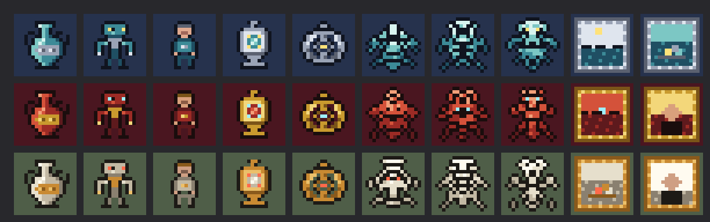
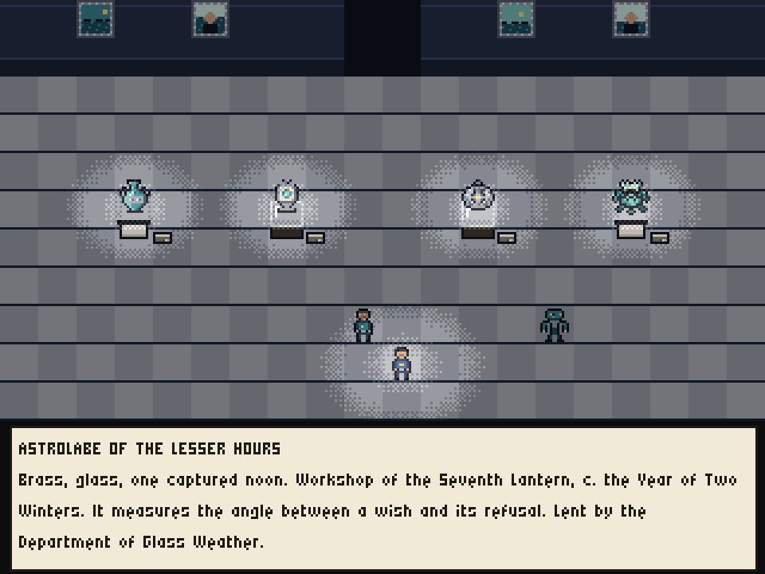

# ACCESSION: design sketch and decisions

*A turn-based roguelike about getting out of a museum too large to have a floor plan. Working title. Design phase: nothing is built yet. Revision 2, 20 October 2026.*

This is the agenda for the conversation Julian asked for before anything is built.

- **Section 3** lists the fourteen decisions that shape everything else. They are ordered by how much they constrain, and each has options, a recommendation and what changes if the recommendation is not taken.
- **Section 4** lists forty-five smaller choices with the default we would take unless Julian objects.
- **Sections 5–14** describe the design those recommendations add up to, briefly, with pointers to the detail.

Where the detail lives:
- **[`design/`](design/):** seven section drafts (core systems, run structure and difficulty, where departments come from, layout generation, the mechanical vocabulary, meta-progression, five worked departments).
- **[`review/`](review/):** six adversarial critiques of those drafts.
- **[`research/`](research/):** seven research briefs the drafts are built on.
- **[`prototypes/`](prototypes/):** throwaway code that backs a few numbers.

Game terms (Certificate, Centrepiece, placard, pips, tombstone line and the rest) are defined in the glossary, §16.

The drafts were written *before* the review. Where they disagree with this document, this document wins, and [`design/README.md`](design/README.md) lists what each draft gets superseded on. Numbers are first drafts for a simulator or a playtest to move. Measured numbers say so.

**How this was made.**
1. **Research.** Seven briefs: the PCG part of *Artificial Intelligence and Games* (2nd edition, chapters 7–9 and 14, with §6.5 and §13.2.2); Julian's work on level generation, quality-diversity and procedural personas; the data-games and LLM-generation line; roguelike and roguelite systems; Calvino, Borges and museum practice; the technical and art pipeline; museum floor plans and space syntax.
2. **Drafting.** Seven section drafts written inside one shared frame. The layout drafter built and measured a generator prototype; the difficulty drafter prototyped the door sequencer.
3. **Review.** Six critics attacked the drafts, each from one lens: fun, PCG research, museal tone and sensitivity, feasibility in this repo, cross-draft consistency, and a new player on a phone. This document is the design after that review.
4. **Verification.** Six further checks of this document: every reference against the paper itself, every claim about the book against its pages, the technical claims against current documentation, every number against the drafts and prototypes, and a cold read against the brief.

---

## 1. The game in two pages

### 1.1 Pitch

You stayed past closing. The doors you came in by are somewhere else now, and the way out lies through departments that rearrange themselves every night: *Instruments That Keep Time Badly*, *A Town Known Only at Low Water*, *Animals Not Yet Seen by the Day Staff*, *Things Kept in Duplicate, Before the Repeal*.

Each department is one level, with its own:
- architecture;
- palette;
- exhibits, asleep on their plinths until you give them a reason not to be;
- one rule that holds only there.

The labels tell you what you need. The tombstone line (the catalogue line under the title: maker, date, medium, credit line, number) is the stat card; a plain *Behaviour* line says what a thing does; the paragraph under it is for reading. You fight, slip past, or leave before the night watch begins its rounds. You may register one object from each department into your own small collection, which grows in the Entrance Hall between visits. When you finally reach the revolving doors, the Registrar would very much like to accession *you*.

**The museum feels infinite.** Its lobby directory lists departments without end, and most of its doors are closed for reinstallation. The departments you can actually enter are a curated collection, written inside an authored vocabulary of behaviours, rules and rooms, played by simulated visitors, and accepted, edited or refused by a human curator. Whether, when and how that collection becomes literally infinite is the first decision (D1).

### 1.2 One department, in two minutes

You come through the door from the last department with 23 of 35 hit points, a pocket watch nobody has catalogued, and a Certificate from a hall of clockwork. The placard on this door read:
- **TIDES II · A TOWN KNOWN ONLY AT LOW WATER**;
- a wave icon (hazard) and an hourglass (attrition);
- the Centrepiece's name, *The Breakwater, Ninth Section*.

The first room is a raised pavement beside a sunken street.
- **The intro panel.** It says the department "holds what the Museum collected from a town that exists only at low water". It ends: "Please keep to the walkways at high water, as the Office's own staff did."
- **The tide gauge.** On the wall, showing a timetable, with a small countdown beside your clock dial.
- **The doorstep.** On the cobbles below, a marble doorstep stands on a low plinth. Step near it and its label line appears: *Doorstep From No. 9, Low Street · marble*, three empty pips (its waking meter), a footprints pictogram. Its Behaviour line reads *Walks to you when woken. Cannot swim.* Its paragraph says the night staff "report that it has never once been seen to float".

Eight turns in, the water starts to rise. You stay on the pavement. The doorstep, which you woke on the way past, steps down into the street to come for you, and is still there when the water reaches the second step. It drowns. The department has taught its rule without a tutorial: the town keeps to the timetable, and anything that cannot swim should not be in the street at high water. That includes you.

The rest of the department is a grand hall:
- a High Street that floods every sixteen turns or so, under balconies that never do;
- an ambulant bronze bollard that charges in straight lines and stuns itself on columns;
- a working model of a harbour crane that pushes visitors into deep water;
- a bell on a float that wakes everything near it if it sees you;
- at the far end, the ninth section of a breakwater, which the sea followed into the museum.

You have three choices with the breakwater:
- **Fight it** from the dry piers, for the department's Certificate and the harbourmaster's pole wedged in its iron cramps.
- **View it.** Stand at the lectern beside it for four turns while it sleeps; that earns the Certificate, and a dust sheet goes over it for the night.
- **Walk out** past it, through the coda room to the exit doors.

Whatever you choose, the closing bell rings on schedule, and after it the night staff start waking whatever is nearest to you.

(This department is worked in full, labels and all, in [`design/samples.md`](design/samples.md) §1, with four others. The sample predates the Behaviour line and the four-turn view.)

### 1.3 A run

A run is one evening's visit. The target is 50 to 75 minutes. The current estimate, from measured layouts at an assumed 80 turns per minute, is 40–45 minutes, so turns per minute, measured in the first playable, sets department size and the clock (D6).

```
ENTRANCE HALL   your Collection · Information Desk · the Directory · 3 doors
   │            (first run only: the Orientation Gallery, with the Guard at Post One)
FLOOR 1         3 departments, each ending in 2–3 doors with placards
   │
STAIR HALL      café (choose one: rest / restore / something museal) · kiosk · Conservator · Registrar's desk
   │
FLOOR 2         3 departments
   │
STAIR HALL
   │
FLOOR 3         2 departments
   │
STAIR HALL
   │
THE EXIT        main hall · the museum shop · the revolving doors · the Registrar
```

- **Depth sets power; the department sets texture.** Departments arrive in random order, so any department can be anyone's third.
  - Exhibits have roles (fodder, skirmisher, artillery, brute, controller, warden), and a role's numbers come from the department's position in the run.
  - The department contributes a challenge type (swarm, artillery, guarded, darkness, hazard, locks, attrition), its own rule, an architecture and a skin.
- **The type of challenge varies by construction.**
  - The sequencer never puts the same primary challenge type in two consecutive departments.
  - The doors out of one room always offer different types.
  - A prototype of the sequencer on a pool of 30, with seven primary types, gave at least five distinct primary types in every one of 200 simulated runs, and six or more in 73.5% (§9.3).
- **Doors are placards.** Each exit door shows the next department's name and number, a one-line blurb, its challenge icons and its Centrepiece. Choosing a door is choosing what kind of trouble to have next.

### 1.4 Between runs

- **Accession.** On leaving a department that you earned a Certificate in, you may register one object you found there into **Your Collection**.
  - Your Collection is a gallery in the Entrance Hall, where your objects stand on plinths with labels written from the run: "Selected by Visitor 1,204 in Run 14, from *A Town Known Only at Low Water*."
  - The object is lent straight back to you for the rest of the evening, so registering it costs nothing.
  - Its *kind* joins future runs' loot pools.
  - One object from the Collection may be borrowed into each later run, normalised so that it helps without carrying the run.
  - This is the brief's "keep a single item from each department", made safe.
- **The Catalogue.** Everything you have seen is catalogued. Repeat encounters reveal more of an exhibit's numbers.
- **A small store of options, not power** (the brief's Vampire Survivors store, selling options instead of stats; D11), paid in Stamps earned by Certificates and escapes. Purchases are fully refundable and every one can be toggled off.
- **Patron membership** (offered in place of the brief's "minor stat bump"; D11). An opt-in assist in labelled tiers, available from the first run and shown on the record of every assisted run.
- **Trustees' Directives.** Pick-your-own difficulty modifiers, after the first escape.
- **Death becomes an exhibit:** "Figure of a Visitor, Reaching (Run 14). Painted plaster. Found in Room 412 at opening, near the Pendulum Warden. Accessioned by the night staff."
- **Escape is a loan.** It is stamped *due for return*, so the next run is the return.

---

## 2. Pillars

Everything in the design serves five pillars and one rule of tone. When a later choice is unclear, these decide it.

### 1. Closed grammar, open sentences

Every department is new to *read* and familiar to *play*.
- **Underneath:** a finite, authored grammar that players learn. About 16 behaviour archetypes, 8 rule modules, 20 item primitives and 10 consumable kinds at v1, and four layout programmes.
- **On top:** an open, generated skin of names, conceits, labels, palettes and motifs.
- **What generation may do:** compose and parameterise the grammar, never write code or numbers.

This keeps roguelike mastery possible when content is generated. Whether the grammar itself can grow by generation is decision D2.

The AI&G book does not rule out generated rules:
- Page 300 says that attempts to generate video-game *rules* have not yet produced games "that anyone (except the creator of the system that creates the games) would want to play". It reads this as evidence of how hard a rule set is to evaluate, made harder in video games by real-time play. ACCESSION is turn-based.
- The same page credits LLM-plus-search generation of novel, playable board games in Ludii (GAVEL).
- Page 299 says rules "are almost impossible to evaluate in isolation from the rest of the game", so a computer must simulate play to judge them. A rule module here is only ever judged by simulating it inside this game.

### 2. The label is the interface

Every exhibit and object carries a museum label in four parts:

| Part | What it carries |
|---|---|
| **Tombstone line** | title · maker or attribution · date · medium · credit line · number. It is the stat card. |
| **Behaviour line** | Plain, fixed wording generated from the department's data and checked against it. |
| **Paragraph** | Literature. It may be strange; it may not contradict the Behaviour line. |
| **Pictograms** | One per mechanical fact, because most players will not read. |

Text is load-bearing because sixteen-pixel sprites cannot carry period or provenance. In CrawLLM's user study, participants picked a generated theme's epoch from four options with only 43% average accuracy (chance: 25%), the worst of the descriptors tested, and the authors argue that themes typically came through only when every detail was highly specific.

### 3. Everything on display is asleep

The game happens after hours.
- **Exhibits begin dormant.** They wake on a small, visible set of causes: your presence, noise, and at most one department- or species-specific trigger such as light, being watched or not being watched, a touched case, or a taken object.
- **Dormancy is the tactical opener.** You choose the order of engagement, and a fight can begin with a surprise attack.
- **A closing-time clock replaces hunger.** A bell, then the night watch, whose rounds wake whatever is nearest to you.

### 4. Depth sets power; the department sets texture

Random order means a department may never fix its own difficulty.
- **Power comes from depth.** Roles scale with run depth.
- **Calibration.** Each department is calibrated by simulation to a target death rate at every depth it can appear at.
- **The department contributes everything else:** its rule, its challenge type, its architecture and its voice.

### 5. An infinite index, a curated collection

The museum *reads* as endless. The Directory, signage and closed doors cost only strings. The departments you can enter are curated. Generation is curation, and the curator's decisions are data.

### Tone: the institution is the joke, never the Other

The register is the Museum of Jurassic Technology's: deadpan, sincere and specific, with some of *Piranesi*'s kindness, and varied on purpose (§8.4).

The absurdity of the classification belongs to the museum's own bureaucracy. Borges paired his "certain Chinese encyclopedia" with the Bibliographical Institute of Brussels, which "also exercises chaos".

The rules that follow from this:
- Cultures are wholly fictional.
- A "faraway land" is a Calvino conceit about a place, present through its practices and its correspondence, not an ethnography.
- There are no human remains, invented or real.
- Provenance is a mechanic, not a sermon (D8).
- Staff are never harmed (D7).

---

## 3. Decisions for Julian

Fourteen decisions. The first thirteen are in the order that the rest depends on them:
- **D1–D3** decide what kind of generative project this is.
- **D4–D8** decide what kind of game it is.
- **D9–D13** decide how it is built and what gets built first.
- **D14** decides how layouts are generated. It was added after the review and constrains little else, so it comes last.

Each decision gives the question, why it matters, the options with their trade-offs, a recommendation with its reason, and what changes if the recommendation is not taken. Smaller choices, each with the default we would take, are in §4.

### D1. Where do departments come from, and is the museum literally infinite?

**Why it matters.** This is the brief's headline question, and it sets the scale of everything downstream: the server, the cost, the curation load, the tooling and the research.

**Three different things get called "infinite" here:**
- **Perceived infinity.** The museum reads as endless. This costs strings: the Directory, signage, closed doors.
- **Playable infinity.** A run can contain a department nobody has played before. This costs generation, validation and moderation per department.
- **Mechanical infinity.** New departments keep changing *how* you play. This needs the grammar itself to grow (D2).

**Two pieces of arithmetic frame the choice.**

*Duds.* A run visits n = 8 departments. If each is independently a dud (broken, unfair, dull) with probability p, a run meets at least one dud with probability 1 − (1 − p)^8.

| p | Runs containing a dud |
|---|---|
| 1% | 8% |
| 2% | 15% |
| 5% | 34% |

*Staleness.* A run draws 8 departments from a pool of N. With uniform draws, the expected number of departments in the next run that the player has never seen, after k runs, is 8(1 − 8/N)^k:

| | After 5 runs | After 10 runs | After 20 runs |
|---|---|---|---|
| Unseen departments in the next run, N = 30 | 1.7 | 0.36 | 0.02 |
| Unseen departments in the next run, N = 100 | 5.3 | 3.5 | 1.5 |
| Good unseen departments in the next run: 6 curated from a pool of 30, plus 2 generated at a 10–35% dud rate | 3.3–3.8 | 1.9–2.4 | 1.4–1.9 |

A curated pool of 30 is mostly explored by run 10. Sustaining one new department per run until run 50 needs a pool of about 200. The dud rate of a gated generator like ours is **unmeasured**. The published evidence comes from systems with no simulation gate that rejects candidates:
- A Rogue Dream's 66% curation coefficient (2014);
- Word2World's full pipeline, whose A*-agent and language-model checks feed back into later generation rounds rather than reject, and which produced playable worlds 9 times out of 10 (60% with a single round).

Our own reject logs would be the first real measurement.

**Options:**

- **(a) Hand-authored set** of 12–20 departments, written with Claude in sessions. The best depth and the lowest risk. A pool of 20 drawn eight at a time is about 80% seen after three runs and over 90% after five, after which the Directory carries all the infinity. A pool this small also cannot feed the full sequencer (§9.3), so runs get shorter.
- **(b) Curated Permanent Collection.** Departments are written offline inside the grammar (for v1, by Claude sessions using the validators as a lint, D13; later, by the batch pipeline once the grammar is frozen), simulated, then accepted, edited or refused by Julian, and shipped as accession-numbered data. About 24–30 at launch, growing through updates. Safe and deterministic, and it keeps the single-file build. Novelty for a dedicated player depends on how often updates come.
- **(c) Runtime generation at the door.** The fiction is literally true. It needs:
  - a server or the player's own API key (a browser cannot hold a key);
  - a gate that runs per request;
  - moderation.

  It also ships an unmeasured dud rate straight to players.
- **(d) Grammar only**, no language model: departments assembled from authored parts and hand-written lexicons. Free and deterministic. Mechanically it is the same as (b), which composes from the same grammar; what it loses is the range of conceits and prose a language model brings. Unless the lexicons are large, the risk is Kate Compton's "10,000 bowls of plain oatmeal": each department technically new, all of them perceptually alike.
- **(e) Staged hybrid.**
  - Start with (b) plus the Directory.
  - Later, add opt-in **Temporary Exhibitions** drawn from a server-side buffer that a nightly automated pipeline fills, with bring-your-own-key as the no-server alternative.
  - They sit behind a door marked "not yet catalogued", never in the first two positions, and always with a free way out.
  - The gate to v2 is measured, not assumed:
    - broken departments ≤ 1% of automated passes;
    - dull ones at a rate Julian finds tolerable for optional content.
- **(f) The Open Stacks.** Everything in (e), plus five things that make the museum *mechanically* infinite rather than only reskinned:
  1. **Modules as data.** Rule modules are written in a small rule language (D2), and an offline LLM-plus-simulation loop proposes new ones, filtered by the same tests as the authored ones, with Julian reviewing.
  2. **A learned surrogate** of the simulation gate pre-screens candidates, so the expensive check runs only on survivors.
  3. **An automated curator**, trained on Julian's curation log and audited through active learning, with Julian labelling the cases it is least sure of.
  4. **Promotion by play.** Door choices, completions and reports promote Temporary Exhibitions into the Permanent Collection, via an Acquisitions Committee in the fiction.
  5. **A route back to no server.** Eventually, an in-browser generator distilled from the gated corpus, in the manner of ELM and Moonshine.

  The cost is a server, nightly compute, engine work for the rule language, and audit hours that fall as the curator improves. The yield is a game whose fiction is literally true, and at least four papers (§13).

**Recommendation: build v1 as (b) plus the Directory, and treat (e) and (f) as the roadmap, decided from data.** Five cheap things in v1 keep (f) open, and none of them changes the v1 game:
1. write the launch modules in the rule language;
2. log every simulation-gate run in a form a surrogate can learn from;
3. run the automated pipeline in shadow beside curation, so the dud rate gets measured;
4. keep finished runs locally and offer an opt-in "Donate this visit to the Archive";
5. log door choices.

**Why.** One spoiled department costs a whole 50–75 minute run, and only offline rejection can push the dud rate near zero before we know what it is. Generating text and specs is cheap, by estimate: about $0.21 for one department in a single interactive pass on Claude Opus 5.5, and about $33 via the Batch API for a launch batch that drafts about 400 frames to present 48 candidates and accept about 30 ([`design/pipeline.md`](design/pipeline.md) §3.11). The binding costs are Julian's time and simulation compute. In v1, made with the authoring aid (D13), that time is editing per department. Once the batch pipeline runs, it is curation, estimated at about 15–30 hours per 48-candidate batch for a thorough review, against the pipeline draft's 8.

**If Julian picks otherwise:**
- *(a):* v1 uses the same authoring aid as (b) but stops at about 15 departments and never builds the batch pipeline. Runs shrink to five or six departments (D6, §9.3).
- *(c):* the server, the per-request gate and moderation move into v1. The first two departments of every run must still come from a pack, so a run never starts by waiting.
- *(f) from the start:* this becomes a research platform first (D3c). The slice in D13 still comes first, because the rule language must be designed against modules that are known to be fun.

### D2. May the generator invent rules, or only compose them?

**Why it matters.** It decides where novelty can come from, and whether "infinite departments" can mean new ways to play rather than new skins.

**Options:**
- **(a) Closed modules.** Each rule module is bespoke code written by people. The generator only selects modules and sets their parameters. Simplest and safest. New mechanics arrive at human pace, a few per update.
- **(b) Modules in a small rule language from day one.** Each module is an event–condition–effect form:
  - the trigger comes from the closed wake/clock/alarm set;
  - the condition is a predicate over tiles, species and items;
  - the effect is one of a closed set of statuses, surfaces, displacements, spawns, light changes and noise;
  - plus a scope and a mandatory telegraph.

  The Behaviour line and the pictograms can be *derived* from the form, so label honesty becomes an exact check rather than a judgment. Cost: an interpreter in the core, and some engine design up front. A few modules (moving shelving, scale models) stay bespoke.
- **(c) (b), plus an offline module-generation loop.** In the manner of ScriptDoctor and GAVEL, an LLM proposes modules in the rule language. Two inputs seed it:
  - the "unmatched concept" queue, where department frames that the grammar could not express are recorded;
  - the frames themselves.

  The candidates are filtered by tests the design already needs:
  - **fires:** the module triggers in at least 90% of simulated seeds;
  - **matters:** a bot that uses the rule beats one that ignores it;
  - **teachable:** the department's intro gallery can require it;
  - **not degenerate.**

  Julian reviews the survivors. A generated module first appears as a secondary rule or inside a Temporary Exhibition, labelled "uncatalogued mechanism", and is accessioned into the permanent grammar only after review.
- **(d) Runtime-generated mechanics.** Not recommended. It loses learnability and every guarantee at once.

**Recommendation: (b) for v1, (c) as the main research track.** Archetypes (how exhibits move and fight) stay closed, because mastery rests on them. Modules are the layer that makes a department feel different, and each one is local: it touches only the departments that carry it. At v1's 8 modules a given module still appears in about three runs in four; at the drafts' 13 it was about half, and the share keeps falling as the library grows. A weak generated module therefore costs less than a weak archetype, which nearly every run depends on. The evaluator (fires, matters, teachable) is specified and gets built in M4. The slice writes its four modules in the rule language; if they do not fit it naturally, fall back to (a) before v1.

**If (a):** nothing in v1 changes except the interpreter, and D1(f) loses its first enabler.

### D3. Is ACCESSION also a research testbed?

**Why it matters.** Most of the interesting research questions need human play data and logs that cost almost nothing to keep if planned from the start, and are impossible to recover later.

**Options:**
- **(a) A game only.** No logs beyond what debugging needs.
- **(b) An instrumented game.** Five channels:
  1. the curation log, with reason codes and a blind first look;
  2. simulation-gate logs in a learnable format;
  3. an opt-in replay donation (a run is `{pack version, core version, seed, actions}`, a few kilobytes);
  4. door-choice logs;
  5. a handful of research flags compiled into the shipped build, for example labels honest or shuffled, the pool curated or automated, novelty weighting on or off.

  Experimental content appears only behind opt-in doors.
- **(c) A research platform first.** Build the Open Stacks server, surrogate and automated curator early, with the game as their front end.

**Recommendation: (b).** It costs a few days and keeps every angle in §13 open. Several of those angles involve Julian's own lines of work, including:
- door choices as free choice data: each choice prefers the chosen placard to each unchosen one, judged before play from placard features. That is related to, but not the same as, the post-play pairwise reports of experience-driven PCG (Pedersen, Togelius & Yannakakis 2010), and it mixes taste with perceived risk;
- a surrogate of the persona battery;
- learning a curator from a curation log;
- knowledge transfer under generated content.

**If (a):** drop the donation button and the research flags; nothing else changes. **If (c):** see D1(f).

### D4. Which way of playing is primary?

**Why it matters.** Requiring fighting, sneaking and leaving to be equally good in every department triples the tuning and makes each path shallower. And fighting has to pay, or the best tactic is always to avoid it: with no experience points and no drops, it pays only through what it guards.

**Options:**
- **(a) Tactics first, with dormancy as the tactical opener** (SPD and Brogue). You choose the order of engagement and start fights with surprise attacks, and sneaking is a strong tool rather than a separate game. Fighting pays:
  - the best cases are guarded by wardens;
  - the Signature piece comes only from defeating the Centrepiece.

  Stealth is the main mode only in departments whose rule makes it so (Guarded, Darkness).
- **(b) Stealth first** (Invisible Inc., Thief). Combat is a failure state and stays thin; guards and light are universal.
- **(c) Parity**, as drafted.

**Recommendation: (a).** The brief asks for turn-based RPG conventions with Shattered Pixel Dungeon as the reference, and never mentions stealth. Dormancy already gives the museum premise its shape (you walk among sleeping exhibits and pick your moment) without making every department a stealth simulation.

**If (b):** guards, light bands and noise become universal (§5.2 moves most of its "department-owned" column into the universal one), combat shrinks to a few verbs, and the complexity budget in D5 must be spent on stealth instead. **If (c):** keep the drafts' parity gates and expect about three times the tuning.

### D5. How many rules does every department share?

**Why it matters.** As drafted, a first-run player meets about 32 systems in the first three departments, roughly three times what Shattered Pixel Dungeon shows in its whole first region (about 10 over 30–45 minutes; the count is in `review/fun.md`). Most of the weight was a universal stealth simulation:
- five awareness states;
- 13 wake triggers;
- noise by floor material against hearing classes;
- five light bands;
- tiptoe;
- guards everywhere;
- two alarm levels.

A six-rung identification ladder and forgeries sat on top.

When the shared layer is that heavy, every department plays as the same heavy simulation with a gimmick on top. That is both the onboarding problem and the sameness problem.

**Options:**
- **(a) A thin universal layer of about ten systems, with departments owning the rest.** The split is in §5.2.
  - Guards and alarms, light-sensitive exhibits, fine-grained noise, forgeries, posing and tours belong to the departments whose rule uses them.
  - Departments switch on at most two such systems each.
  - In a player's first runs, a department may introduce at most two systems the player has not met.
- **(b) The drafts' rich universal layer**, made more readable (presence ring, visible noise, trimmed triggers).
- **(c) Pure Shattered Pixel Dungeon:** dormancy only, no light, no noise model, the departments differing by monsters and terrain.

**Recommendation: (a).** It makes "the department where noise matters" and "the department with guards" into identities. It gives random order a curriculum, and it cuts the first-run glyph count to about fifteen. It is also the fix for sameness: a department is distinct when its rule changes *what you target or watch*, not when it adds a hazard overlay to the same fight.

**If (b):** onboarding needs the full staged-disclosure plan in `review/newplayer.md` §8, and the first-playable estimate grows by about a third. **If (c):** the museum premise thins to a skin.

### D6. How long is a run, and how is the route chosen?

**Why it matters.** Run length sets department size, the clock, the pool size the sequencer needs, and whether this is a phone game.

**What was measured.** The clock and the run length were first sized on tours of 150, 220 and 280 tiles, by department size. On 3,600 generated layouts the layout prototype measured median tours of 59–77, 84–108 and 115–177 tiles, roughly half. At an assumed 80 turns per minute (itself unmeasured), eight departments then make about 40–45 minutes, not 82, and below the 50–75 minute target. At 50–60 turns per minute, plausible once fights, reading and decisions are counted, the same layouts make about 55–70 minutes. Turns per minute is the first number the slice gate measures.

**Options:**

*Departments per run:*
- **5 larger departments.** Half the content and calibration. At most five challenge types per run, and it reads as a small museum.
- **6 (2/2/2).** Fits a smaller pool (about 18, by the drafts' estimate; not rerun).
- **8 on three floors (3/3/2).** Matches the brief's "infinite collection of departments, organized in no discernible manner", carries the challenge-type variety guarantee, and puts the floor breaks where SPD puts its progression beats. Needs a pool of about 20 for 2-door offers and about 28 for 3-door offers (§9.3).
- **12.** The most "infinite"; departments too short for their own arc; centrepiece fatigue.

*Route choice:*
- **Linear** (SPD).
- **Doors with placards** (Hades).
- **A full map** (Slay the Spire).

**Recommendation: 8 departments on three floors, doors with placards, plus a per-floor Directory at each Stair Hall** showing the coming floor's challenge icons, and one size class in v1. Set the final count and the clock at the first-playable gate from measured turns per minute. If departments come in at about 6–9 minutes, keep 8 (about 50–75 minutes a run); if well over, drop to 6; if well under, make departments larger rather than adding more.

**If 5 or 6:** Stair Halls come every two departments, and per-department danger rises to keep run-clear rates. **If a full map:** placards need a compact rendering on phones.

### D7. Who is the player, and how does the museum treat them?

**Why it matters.** It decides the ethics of looting, what guards are for, how a run can end, and what the finale means.

**Recommendation, as one package:**
- **You are a visitor who stayed past closing.** Your class is the trade you bring with you (D9): a night guard from another museum, a copyist, a conservator, a docent. Here you are a visitor like any other.
- **Staff are never harmed.** That covers daytime guards, the night watch and the Registrar.
  - Daytime guards police you *only in Guarded departments*. Elsewhere they are neutral people who give directions.
  - **The night watch** is the end of the closing clock in every department. It is non-lethal itself; its rounds wake the exhibits nearest to you.
- **Capture has one rule:** you are walked to the department's exit doors, keep what you carry and any Certificate already earned, and lose the department's unfound highlights. No confiscation, no teleport back to the entrance.
- **Retiring counts as dying** for everything that persists. Otherwise retiring at low health beats dying, and players feel obliged to do it.
- **The museum is benevolent, and it is doing its job, which includes collecting you.** The Exit is a retrospective:
  - The Registrar has no hit points. It re-hangs exhibits from *your* run between you and the revolving doors, and pins Accession tags on you, one per telegraphed stamp you fail to avoid and one per stretch of time you stay in the hall, so waiting is not a strategy.
  - Each tag writes a field of your own label as you watch: maker, date, medium, credit line.
  - At ten tags you are accessioned, and that is a loss.
  - Reach the doors and you leave *on loan, due for return*.
  - A consent ending, in which you sign yourself in, can come later.

**Options against this:**
- **Guards that can be fought.** Simplest to build, but violence against staff breaks the tone the rest depends on.
- **A hostile museum.** More conventional horror; loses the Piranesi kindness and the joke.
- **A boss fight at the Exit.** It contradicts "staff are never harmed" and forces stealth builds into a fight at the end.

**If guards can be fought:** the Guarded challenge type becomes a combat type and the tone line moves.

### D8. How does the game handle provenance, "faraway lands" and peoples?

**Why it matters.** Universal museums were filled largely through empire. A loop of *enter the faraway department, defeat its inhabitants, take its objects* reproduces that history whether we mean it to or not, and so does a generator left to its defaults: a sensitivity check that asks "which real group does this read as?" but never "how did the Museum get these things?" misses it. The literary models carry the same baggage. Calvino's frame is Marco Polo reporting to Kublai Khan, and Borges's absurd taxonomy is credited to a "certain Chinese encyclopedia".

**Options:**
- **(a) Wholly fictional, and silent.** No real cultures and no provenance mechanics. Safe, but the tone pillar's provenance rule would then have no mechanic behind it.
- **(b) Fictional, with provenance as a light mechanic from v1:**
  - **Conditions of gift.** The worked samples already contain four, among them a bell given "on condition that it not be rung", a lever given "on condition that it be used rather than displayed". Honour one for a relation (a shortcut, a loan, a reputation); breach it for raw power and a closed room.
  - **A Returns desk.** Objects whose credit line reads "found in the collection, circumstances unrecorded" are strong but carry a claim. Returning one trades power for a relation.
  - **Lands inhabited by practice and correspondence.** A town present through its harbour office's letters and its sweepers' brooms, never through costume, ritual or bodies.
  - **A Lenders family**, later: at most one per run, its keepers unharmable, with loans, refusals and closed rooms.
  - **An acquisition-mode check in the generator:** expedition and salvage stories are not the default way things arrived.
- **(c) Provenance central.** A Courier class whose objective is carrying an object home, and repatriation as a win condition, at launch.

**Recommendation: (b), with (c)'s Courier as a later class.** It keeps the argument in the mechanics and the credit lines, never in a lecture. Fred Wilson's *Mining the Museum* (1992–93) is the model; in Elisabeth Ginsberg's words, it "worked because it was suggestive rather than didactic".

**If (a):** strike provenance from the pillars rather than keep an empty one. **If (c):** the Courier and the Lenders move to launch and need a sensitivity review process first.

### D9. How does a run make you stronger, and who can you play?

**Why it matters.** It is the second-largest piece of the moment-to-moment game after combat, and it decides whether stealth and leaving early are real options. It is also the largest departure from the brief's turn-based RPG conventions: SPD has experience levels, and this recommendation does not.

**Recommendation:**
- **No experience points** (Brogue). Power comes from fixed quotas, so the median build at each depth is predictable, and §9.1 scales every role against that build; experience from a variable number of kills would not be predictable. It also means that slipping past an exhibit costs no power. Power comes from three sources:
  - **Restoration kits**, the single upgrade currency;
  - **Handling Clearance**, the strength analogue, which also opens locked cases;
  - the department's **Certificate**: more hit points and one perk from three.
- **Guaranteed quotas.** Two kits and one Clearance card per department, from decks keyed to depth. They are never hidden in secret rooms, and they are shown on a "Highlights of this collection" card, as SPD tells its players its guarantees.
- **Perks.** 12–16 general, triggered perks in a few playstyle families (close work, at a distance, quiet feet, old hand). Perks tied to challenge types would rarely pay, because the sequencer seldom repeats a challenge type within a run.
- **Classes.** The **Night Guard** at launch.
  - The **Copyist** second, after the first playable. Its verb is *sketching*: studying a sleeping exhibit for a few turns gives a page, *After the Escapement Hound*, which grants a weaker copy of its ability.
  - Then the Conservator and the Docent.
  - The Courier comes later (D8).

**Options against this:**
- **SPD-style experience levels plus talents.** Conventional; makes stealth and leaving early cost power, and the build at each depth varies with how much was killed.
- **Experience from Centrepieces and wardens only**, a few levels per run. The convention kept, with its variance bounded.
- **Experience from discovery** (reading labels, cataloguing). Makes reading mandatory and grindable.
- **The sketch as a universal verb for every class.** A chore at half strength, and it overlaps with viewing the Centrepiece as "the reward for looking".

**If experience levels:** §9.1's role curves are fitted against a distribution of builds per depth rather than one, and the clock must be checked against farming. **If the sketch is universal:** every class gets one sketch page, and the balance tables double for every special.

### D10. What do labels carry, and how are objects identified?

**Why it matters.** Pillar 2 rests on it, and two obvious designs work against it.

1. **The attribution ladder.** Using the qualifiers (*Manner of* … *Workshop of* … *Attributed to* … *By*) as a progress bar, so that every object you study ends up "By" a named hand, runs backwards: in real cataloguing, closer study more often *demotes* an attribution.
2. **The one true sentence.** Requiring each label's prose to carry exactly one true mechanical observation turns labels into a form. In the worked samples the same sentence recurs for the same archetype, and most labels end on a reporting formula ("keepers report…") or a punchline.

**Recommendation:**
- **The mechanics move into the Behaviour line.** It sits on the tombstone, generated from the department's data in fixed plain words ("Moves only on every second turn. Follows anything that ticks."), and is checked exactly.
- **The paragraph is then free to be literature, in varied registers.** It must not contradict the Behaviour line. Its house rule: *the object may be absurd; the sentence may not be witty.*
- **For a player's first three runs, the Behaviour line also shows in the proximity strip**, under the title.
- **Consumables are identified as in SPD:** a per-run seal shuffle over a small fixed set of kinds, identified by use, by reading the department's labels, or by a catalogue card. It is cheap and it is the best part of the identification game.
- **Equipment is known on pickup in the first playable.**
- **In v1, equipment adopts the museal split.**
  - *Catalogued or not* is your knowledge.
  - *Attribution* is the object's hidden quality band (*By*, *Workshop of*, *Follower of*, *After*), and cataloguing reveals it, up or down.
  - Forgeries live in the Copies family of departments and in one Trustees' Directive, not everywhere.

**Options against this:**
- **A six-rung identification ladder with forgeries everywhere.** Most rungs are transient states nobody cares about.
- **No equipment identification at all.** Simplest; loses a museal verb.
- **Mechanics as pictograms only, with no Behaviour line.** Purest prose, but the label stops being the interface.

**If the six-rung ladder:** about six more identification states in the interface and in the first-run glyph count (D5). **If no equipment identification:** attribution bands and forgeries leave the item tables. **If pictograms only:** the exact check moves to the pictograms, and the paragraph has to carry the mechanics again.

### D11. What persists between runs?

**Why it matters.** The brief floats three ideas: keep one item per department, minor stat bumps, and a Vampire Survivors-style store. Hades does this best, but needs a story.

**The three ideas, taken literally:**
- **One item per department, all kept.** An 8-department run hands the next run up to eight items, so early departments become trivial within two runs.
- **Mandatory stat bumps.** They blur whether you got better or just stronger.
- **A store of stat power.** It does the same thing faster.

**Recommendation, in two tiers:**

*v1:*
- **Accession** (the first idea, made safe; §1.4), with a single **Loan** slot normalised to the current floor.
- **Your Collection** as a gallery.
- **The Catalogue.**
- **Death as an exhibit.**
- **Patron membership**, offered in place of the second idea: an opt-in assist available from run 1 and labelled on the record. It is not earned by play.

*v1.x:*
- **Stamps and a Gift Shop of options, not power**, offered in place of the third idea: the store sells options, not stats. It sells alternate starting kits, Information Desk choices, lenses that bias which departments the doors offer, and similar. Every item is refundable and can be toggled.
- **Trustees' Directives** as the heat ladder (Hades' term for opt-in difficulty modifiers) after the first escape. The values are fitted by simulation, not declared.
- **The Atlas** of families by ordinal, as a completion record.
- **Lost Property** (one object from your last death, claimable in the next run), **Today's Exhibition** (a daily seed) and **conduct feats** (Brogue-style self-imposed challenges, recorded but unrewarded).

*v2:*
- **Commissions.** Players compose a department request from index cards collected in runs, and it is realised offline.

**Options against this:**
- **The literal ideas above.**
- **Capped earned power**, as in Hades' Mirror of Night. Stamps buy small permanent bonuses (a few hit points, one more starting consumable), refundable, with the total held under a declared cap in the same harness as the Loan (§11). It is the closest to the brief. The cost is that a clear partly measures hours played.
- **SPD's purist line** (badges, seeds and challenges only), which is clearest for self-evaluation but has the least pull for a casual player.

The recommendation prefers options to stats because depth calibration pins the median build (pillar 4): any stat bonus moves every department's measured difficulty for that player. If Julian wants the brief's stat bump, the capped store is the form to take.

**If capped earned power:** its cap joins the §11 table, and the harness calibrates departments at both ends of it. **If the purist line:** keep Accession as display only, with no kind unlocks and no Loan.

### D12. Platform, stack and look

**Why it matters.** Mostly it does not: the stack follows the repo's convention and is listed so that it can be overridden. The live choices are phone-first portrait, which sets the interface budget (a two-row strip at 390 pixels wide), and keeping language models out of the runtime.

**Recommendation:**
- **Code.** Vanilla JavaScript and classic scripts with a single-file `dist/` build, the repo's convention as in `vanguard-zero/` and `grift-city/`. Canvas 2D as in `vanguard-zero/`, with the label text in an HTML overlay.
- **A pure, deterministic, integer simulation core.** The same file runs:
  - the browser game;
  - the bots in Node;
  - the generator's simulation gate.

  Named random streams and no floating-point transcendentals in gameplay code. A cross-engine hash test (Node, Chromium, WebKit, Firefox) from the first week.
- **Phone-first portrait, equally playable on a laptop**, with tap-to-path and Shattered Pixel Dungeon's conventions as ideas only (SPD is GPLv3; this repo is MIT).
- **Graphics.**
  - 16×16 tiles.
  - Sprites as palette-indexed grids drawn in code, with archetype silhouettes, ornament overlays, department palette ramps, and seeded mask-generated beings after Bollinger.
  - **Offline LLM-authored 16×16 grids for signature exhibits**, validated by code. In a research probe, five such grids written without looking at any image all rendered recognisably (five grids, written and judged by the Claude session that made them; not yet judged by people).
  - At most six meaning-carrying colours, with shape always carrying meaning too.
- **Sound.** The repo's own SNES-style synthesiser and tracker from `vanguard-zero/`, with a short motif per department.
- **Language models only offline**, in tools. The game never calls one at runtime in v1.

**Options against this:**
- **Phaser or PixiJS.** WebGL batching a turn-based 16-pixel game does not need.
- **Godot.** A mature editor and native exports; breaks the code-only, Node-testable pattern.
- **TypeScript with a bundler.** Types, at the cost of running straight from `file://`.
- **Diffusion-model sprites.** The closest precedent, CrawLLM, documents inconsistent characters and wall/floor confusion. Reserve diffusion, if anywhere, for an optional close-up view of the paintings on the walls.

**If Godot or a bundler:** the simulation gate needs a headless build of the same core, and the single-file `file://` build goes. **If landscape or desktop first:** the label strip and the placards get room to breathe, and the phone becomes a port.

### D13. What is built first, and how are v1's departments made?

**Why it matters.** As drafted, the design is about 50,000–70,000 lines of code plus a second product (the generation pipeline). That is three to four times the largest game in this repo. This repo's history says plans grow about four-fold in the building, and large designs get built as slices.

**Recommendation: a vertical slice that answers one question first.** Do three departments with different rules, drawn from one grammar, on generated museum layouts, read as a museum and play as a roguelike for a stranger on a phone?

The slice contains:
- **three hand-authored departments** from the worked samples, trimmed: *Animals Not Yet Seen by the Day Staff*, *Things Kept in Duplicate, Before the Repeal* and *Long Galleries, Considered as Telegraph Lines*;
- **two layout embedders** (enfilade and quadrangle);
- **one class**;
- **no generation pipeline, no persona calibration, no meta** beyond a death label and one accession slot.

Bots check only failures: reachability, soft-locks, a worst-case runner, modules firing. The numbers come from human play. It ends in a written human-play gate with three to five players who have not seen the design, measuring:
- turns per minute;
- minutes per department;
- the share of labels opened;
- whether players can say why an exhibit woke.

Estimated at about ten weeks of AI-assisted sessions to the slice gate, playtest included (milestones in §14); the feasibility review's own summary says 4–8 weeks.

**Alongside, off the critical path:** a one-week spike of the first two pipeline stages on 20 recipes, to measure:
- whether the department schema compiles under structured outputs;
- the pass rate after repair;
- cost per department;
- Julian's minutes per department, timed with a stopwatch.

**How v1's 24–30 departments then get made:**
- **(a) Authoring aid (recommended).** Claude sessions write departments against the machine-readable grammar, run the same validators as a command-line lint, and Julian edits.
- **(b) The batch pipeline** from S1 to S7, but only after the grammar stops changing.

**Two documents.** This file holds the decisions. A `BUILD.md` of at most about 10,000 words will be written *after* them: it is the build contract, with a single numbers-of-record table that a lint checks against the code. The 128,000 words of drafts are reference material, not a contract.

**If Julian wants the pipeline first:** it can be built in parallel, but every department it produces before the slice gate is calibrated against rules that may not survive.

### D14. How are layouts generated?

**Why it matters.** The brief asks how the levels will be generated. Layout is necessary, functional content made at runtime, so the method decides what can be guaranteed about every room a player enters. §10 describes the generator in detail; this decision is about the method.

**Options:**
- **(a) Constructive programmes at runtime, with validation, repair and a certified fallback.** Each department names an architectural programme. A mission graph is embedded, furnished and populated in one pass, then checked by validators and a worst-case runner, repaired locally, reseeded, or replaced by a certified layout (§10.3). Measured at about 7–9 ms median per layout in Node, with no retries in 3,600 layouts (§10.4). Every visit gets a new floor plan, and its quality is whatever the validators can check.
- **(b) Search or quality-diversity at runtime.** Evolve each layout per visit against fitness and descriptors. More control over feel, but at the prototype's speed a 50 ms phone budget fits about five candidate layouts, and a searched layout is harder to certify.
- **(c) Pre-generated, curated layouts per department.** Generate offline, keep a few elites per department, ship them in the pack. Every layout can be played by the persona battery and approved. But a department then plays the same, or nearly, on every visit; layouts become content to curate; and the pack grows.
- **(d) (a) at runtime, with quality-diversity offline over each programme's parameters**, as [`design/layout.md`](design/layout.md) §13.4 proposes. MAP-Elites runs over a programme's knobs (loop distance, number of sections, case density and the like), with route structure and museal texture as the archive's axes and playability alone as the fitness: the share of seeds that pass validation without repair (default 36). The archive holds generators, not levels, in the manner of Earle et al. 2022. Each elite becomes a *knob preset*; at runtime a department draws a preset and jitters it. About 15 core-hours, overnight, for all programmes and sizes.

**Recommendation: (d), with (a) alone in the slice.** Runtime construction is fast, can be certified, and gives every visit a new floor plan, which is what "rearranges itself every night" promises. Quality-diversity over parameters rather than levels lets descriptors and, later, the persona battery shape the layouts without spending runtime on search. The curator can also pin presets per department in S6, which keeps the useful part of (c). The slice ships hand-set knobs; the archive comes with v1's programmes. Space-syntax descriptors for it are research angle 10 (§13.3).

**If (a) alone:** knobs stay hand-set; nothing else changes, and (d) can be added later without touching the runtime. **If (b):** budget phone time first; search needs a Web Worker or a much faster generator. **If (c):** layouts become curated content with their own review cost, departments lose their night-to-night variation, and "rearranges itself every night" is true only of the order.

---

## 4. Smaller choices: the defaults we will take unless Julian objects

These came out of the drafts and the review. Most are settled by a decision above or by the critics' findings. Each points to where it is argued. "CS", "Diff", "P", "L", "V", "M" and "S" are the section drafts in `design/` (core systems, difficulty, pipeline, layout, vocabulary, meta, samples); "review/x" is a critique; "tech-art" and "research/museum-layouts" are research briefs; a bare D*n* is a decision in §3.

### Combat and awareness

| # | Default | Why, and where |
|---|---|---|
| 1 | Hit chance from one table, `75 + 5 × (accuracy − evasion)`, clamped to 10–95%, rolled on d100; damage is a range minus flat Padding, minimum 1; no random criticals | Easy to state in the examine readout, easy to tune (CS §2) |
| 2 | Telegraphed specials never miss and never lie: the marked tiles show the exact damage you would take | Into the Breach's lesson (CS §2.4) |
| 3 | Examining a creature shows a sentence modelled on Brogue's: "…has an 85% chance to hit you, typically hits for 20% of your current health, and at worst, could defeat you in 4 hits" | CS §2.7 |
| 4 | Awareness has three visible states (asleep, stirring with three pips, awake), plus a **presence ring** always drawn around the player. Exhibits inside the ring with line of sight stir. Each species has at most one special trigger, shown as its single pictogram | review/fun MAJOR 1 replaces CS's 13-trigger, per-material model |
| 5 | No tiptoe. Loud floors (shards, water) enlarge the ring instead | review/fun MAJOR 1: tiptoe doubled the pips you collected |
| 6 | The closing clock has two stages: **the bell**, which stops pip decay and slows regeneration, then **the night watch**. Budget set from measured layouts and measured turns per minute | review/fun MAJOR 4 |
| 7 | Players have 360° vision. "Moves only when not observed" is defined by line of sight and light, not facing | review/newplayer M6 |
| 8 | Reading a label is free but needs you to be close and the plaque to be lit. Reading in the dark counts as a one-turn lantern flash | CS §1.3; review/fun MINOR 8 |
| 9 | Viewing the Centrepiece means four turns at the lectern inside its wake radius. It earns the Certificate and "closes the exhibit" for the night, so no fight follows. Defeat earns the Certificate and the Signature piece | review/fun MAJOR 2 |
| 10 | Exhibits drop nothing; the loot is in the cases. Wardens guard the best cases. "Fragments" from destroyed exhibits can come later | CS §6.6; D4 (fighting has to pay) |
| 11 | Glass breaks: it is noisy, leaves shards and releases what is inside. Breaking a case is the museum's big risk-for-reward verb | research/museum-layouts D7; CS §4.1 |

### Items and progression

| # | Default | Why, and where |
|---|---|---|
| 12 | Eight consumable kinds in the first playable, ten in v1, twelve in the full game. One list, owned by CS. About 4–5 placed per department. Shops only at Stair Halls | review/fun MINOR 2; review/consistency B1 |
| 13 | A "Signature piece" (one name for the drafts' keepable, Signature piece and accession pick) may carry one rider tied to its department's rule, from a closed list | S D-S3(b) |
| 14 | One size class of department in v1 (Wings strictly beat Cabinets when every door at a depth is tuned to the same death rate) | review/fun MAJOR 5 |
| 15 | The Stair Hall café offers one of three: rest, a free Restoration level, or something museal that competes (a Loan Desk swap, a perk reroll). "Catalogue everything" was dominated | Diff R11; review/fun MINOR 7 |

### Run structure and difficulty

| # | Default | Why, and where |
|---|---|---|
| 16 | The target death curve rises within each floor and relaxes after each Stair Hall: 3, 5, 7 \| 6, 8, 10 \| 10, 12 \| Exit 15 (% per department: the median across the six personas, at median skill). That gives about 45% run clears at median skill. **Plus a novice gate:** a simulated novice's death rate may not exceed about 2.5–3× the target at any depth | Diff §3.9; review/pcg M3 |
| 17 | Challenge types: swarm, artillery, guarded, darkness, hazard, locks and attrition as primaries; social only as a secondary until the Lenders exist. One table, owned by Diff | Diff R6; review/consistency |
| 18 | Every department's first encounters come from an easy "orientation" pool and teach its rule. Once a player has documented a rule in the Catalogue, a "Members' entrance" lets them skip the teaching gallery | Diff §3.6; review/fun MINOR 5 |
| 19 | No hidden difficulty adaptation. The door offers prefer departments the player has not seen recently. An openly labelled "Curator's Recommendation" door is a research option | Diff R12; review/pcg M6 |
| 20 | Heat is pick-your-own Trustees' Directives, mostly *adding* complications (crowds, champions, a power cut) rather than removing tools, with values fitted by simulation | Diff §7 |
| 21 | Patron membership: one model. Opt-in damage reduction in labelled tiers, from run 1, in Settings, never blocking content | review/consistency M5 |
| 22 | A first-department rule for first-time players: no sealed Centrepiece hall, a gentler clock, a fixed easy layout. This is onboarding, not adaptation | review/newplayer M2 |

### Onboarding, interface and accessibility

| # | Default | Why, and where |
|---|---|---|
| 23 | An authored **Orientation Gallery** before the first department of the first run (about three minutes, five rooms, the Guard at Post One). In runs 1–3, the staff guard in each department's vestibule speaks its one essential line ("Water's turning. Get up the stairs.") | review/newplayer §7 |
| 24 | A two-row proximity strip on phones: a short title (≤ 18 characters) with state and pips, then pictograms. The full label opens on tap | review/newplayer B2 |
| 25 | Every timed hazard gets a countdown beside the clock dial. Every informative sound has a visual twin and a caption. Edge markers for off-screen threats; auto-pan when a telegraph targets you | review/newplayer M4–M5 |
| 26 | At most six meaning-carrying colours; meaning always carried by shape as well; a colour-blindness check in the screenshot tests; a readable-font option with size steps | review/newplayer M8 |
| 27 | A naming pass and a one-page glossary: "Loan", "Catalogue", "Guard", "Exhibition" and "After" each meant several things in the drafts. "Centrepiece" replaces "Masterpiece" | review/newplayer M7; review/museal m1 |

### Fiction and text

| # | Default | Why, and where |
|---|---|---|
| 28 | Keep ACCESSION as the title. Alternatives: NOT ON VIEW, AFTER HOURS (and ATTRIBUTED TO, if D10's attribution split is taken). *The Celestial Emporium* is struck: it is the Borges passage that carries the othering problem | review/museal m2 |
| 29 | Every department frame carries a **register** (institutional, lyric, natural-historical, technical, domestic, epistolary…), with institutional comedy at most a quarter of the pool. The sequencer alternates registers | review/museal B1: "Office" appeared 131 times in five samples |
| 30 | An **audio guide** as the frame voice, the game's Marco Polo: a narrator recorded in the daytime and heard at night, in about 30 short Stair Hall interludes in v1 (about 1,800 words), with stops per department later | review/museal M7 |
| 31 | Conservation as play, in v1.x: over-restoring an object past +2 can lower its attribution; treatments are reversible at the Stair Hall; light fades paper and textile | review/museal M8 |
| 32 | The Directory mixes a grammar with about 60 hand-written lines whose two halves depend on each other (§7.4) | S §7 |

### Generation and evaluation

| # | Default | Why, and where |
|---|---|---|
| 33 | Language models write names, prose and choices among grammar ids. They never write numbers, layouts or code that runs | P §2.2 |
| 34 | Diversity comes from what each generation call is given (domain pairs, constraint cards, register, target), never from sampling temperature (which current Claude models reject) and never by generating one department from another | P §3.2; tech-art F5 |
| 35 | The department-level archive is called what it is, a *stratified coverage grid*. MAP-Elites runs where evaluation is cheap: encounters and bestiaries (an analogue of Mech-Elites), Centrepiece assemblies, and items and perk builds | review/pcg M2 |
| 36 | Fitness for any search is playability only. Skill gap and route divergence are *bands*, not objectives | review/pcg M3; Khalifa et al. 2018 |
| 37 | One machine-readable registry of the grammar. It generates the documentation tables, the language-model enums, the pictogram list and the test stubs, and a lint rejects unknown ids | review/feasibility M6 |
| 38 | One simulation-gate table, owned by Diff, with stated statistical power (about 200 seeds per depth, not 50) | review/pcg M4 |
| 39 | Seeds for the domain lexicon may come from open museum vocabularies, materials and techniques only, never cultures, places or people. Candidates are the Getty Art & Architecture Thesaurus and the medium fields of open-access collections; each source's licence is to be checked. This is a data-games experiment (open data vs LLM-only seeding) | review/pcg m3 |
| 40 | Accession numbers are readable codes (family letter, department, item) and also key the per-department random streams, by pinned version rather than by content digest, so a label edit never reshuffles a layout | P §6.3; review/feasibility M1 |

### Engineering

| # | Default | Why, and where |
|---|---|---|
| 41 | Saves are state snapshots stamped with the code version, not action-log replays, which break on every deploy. Two alternating localStorage slots with checksums; `navigator.storage.persist()` where the browser grants it; an installable web app; and an export code ("visitor's card"), the only safeguard in an ordinary Safari tab (§11) | review/feasibility M7; tech-art F15 |
| 42 | One canonical hosted build (GitHub Pages, top level, installable), still playable from `file://` | review/feasibility F5 |
| 43 | Share codes and daily seeds carry the slice of meta state that changes doors and pools; without it, the same seed does not give the same run | review/feasibility M1 |

### People and money

| # | Default | Why, and where |
|---|---|---|
| 44 | Topic NPCs (§6.5): none in the first playable. In v1, about one department in three has one person drawn from its subject: a fellow visitor (a trade, gossip about a highlight, or an escort to the exit doors) or a docent (a gallery talk, without tours). Lenders' keepers come later (D8) | The brief's NPCs drawn from the topic; CS §11. Tours stay with Attendance (§5.2) |
| 45 | Coins are the in-run currency: about 30–50 per department, from donation boxes, fountains and fellow visitors, spent at the Stair Hall kiosk, the Conservator and the Registrar's desk. The kiosk never buys | CS §11; no buyback, after DCSS |

---

## 5. Moment to moment

### 5.1 The core loop

Underneath every system is the core loop to protect: **a case-heist loop over sleeping exhibits.**

You enter a gallery. Cases line the walls. Some hold objects; some hold exhibits that are not quite objects. You decide what to wake and in what order:
- kill the warden standing over the best case while it sleeps;
- skirt the swarm along the far wall;
- open the vitrine with your Clearance, or break it and deal with whatever the noise wakes.

What wakes up fights by rules you can read: dice for ordinary blows, and exact, telegraphed numbers for anything dangerous. The clock keeps the evening finite. At the end of the department a Centrepiece waits, to be fought, viewed or left alone. Then three doors offer three kinds of trouble.

**The choices a player makes,** in one list:
- **In a gallery:** what to wake and in what order; fight, slip past or leave; open a case with Clearance or break it.
- **At the Centrepiece:** fight it for the Certificate and the Signature piece, view it for the Certificate alone, or walk out.
- **Between departments:** which door, by its placard; which object to accession; which perk of three.
- **At a Stair Hall:** one café service of three (rest, a free Restoration level, or something museal); what to buy at the kiosk; what to ask of the Conservator and the Registrar.
- **Across the run:** where Restoration kits and Clearance go; when to use, or risk using, an unidentified consumable.
- **Between runs:** which object to borrow as the Loan; later, which options to buy and which Directives to accept.

### 5.2 What every department shares, and what departments own

This is decision D5's recommendation in one table. The universal column is what a player learns once. The other column is what makes a department a place.

| Universal: every department, from run 1 | Owned: switched on by a department's rule, at most two per department |
|---|---|
| 1. Turns and bump combat: dice for ordinary blows, telegraphed exact specials, the odds readout on examine | Staff guards, alarms and capture: Guarded departments |
| 2. Health, slow regeneration, benches to sit on | Light- and dark-sensitive exhibits, light levels set by the material on display: Light |
| 3. Dormancy: asleep, stirring (three pips), awake. A presence ring around you. Fighting and breaking glass make noise in three loudness classes | Fine-grained hearing (exhibits that hunt anything that ticks): Machines |
| 4. Light in three bands (lit, dim, dark) and a lantern you can switch on and off | Tides and floods on a timetable: Tides |
| 5. Cases: vitrines block movement but not sight; open them with Clearance or break them | Demonstrations on the hour: Machines |
| 6. The closing clock: the bell, then the night watch | Originals and copies, where breaking the original weakens its copies; forgeries: Copies |
| 7. Equipment (a weapon, a garment, two curios, an instrument) and Handling Clearance | An arbitrary taxonomy: wake one member of a class and its classmates stir; sorting vaults: Classification |
| 8. Restoration kits and the visible "Highlights of this collection" quotas | Exhibits that move only when nobody is looking: Specimens |
| 9. Consumable kinds with per-run seals | Posing on an empty plinth, tours, being watched: Attendance (later) |
| 10. The Centrepiece and its Certificate (defeat, view, skip), and perks | Rooms that fade from the map if you do not revisit them: Memory (later) |
| 11. Doors with placards | Keepers, loans and consent: Lenders (later) |

The interface carrying all of this is the label and its pictograms (§8). A department of ordinal I (the simplest in its family; the sequencer's complexity cap places these early in every run) switches on one owned system. Later ordinals may combine two.

### 5.3 The rules in brief

The full specification is [`design/core-systems.md`](design/core-systems.md), with the changes in §4 above.

**Time and stats.**
- **Time.** Integer ticks, 100 per turn, with per-action costs. Examining and reading cost nothing; searching costs three turns.
- **Starting stats.** 20 health and +5 per Certificate. Accuracy, evasion and Padding (flat damage reduction from the garment). Handling Clearance starts at 10 and rises by one card per department.

**Role curves.** A role's numbers come from depth and stay in lockstep with the median player build, so a role means the same threat at every depth:
- fodder dies in about two hits and takes about 6–9% of your health per hit;
- a brute takes about 20%;
- a telegraphed special about 25–30%.

**Weapons.** Four forms (light, balanced, heavy, reach) and five tiers, with the tier set by run depth, never by the department.

**Consumables.** Kinds such as *Consolidant* (heals), *Fixative* (roots whatever it lands on), *Solvent* (dissolves case glass silently), *Catalogue Card* (identifies), *Floor Plan* and *"Quiet, Please"* (settles everything nearby). Each department gives them its own local names: "Rainwater, Collected at Slack Tide"; "Notice: Clocks Stopped for Cleaning".

**Two worked numbers.** At department 4, circling a sculpture court to win back 10 health costs about 110 turns, a sixth of the drafted open hours, and after the bell it costs twice that. That is the answer to pillar-dancing (circling an obstacle to regenerate while a slower exhibit follows). A surprise attack on a sleeping exhibit always hits, for maximum damage.

---

## 6. A department

### 6.1 Anatomy

A department is data in layers, and every field is tagged by who may write it.

| Layer | Holds | Written by |
|---|---|---|
| Recipe | Family, subject, seed domains, constraint card, register, target cell | Code (the batch planner) or a person |
| Frame | Title, conceit, domains, collecting policy, founder, calendar anchor, register, house rule, claimed challenge, programme, palette, pitches | A language model choosing from closed lists plus free text, or a person |
| Spec | The rule modules, the species (archetype + modifiers + role), the Centrepiece assembly, items as primitives, the Signature piece, consumable skins, NPCs, and a *trace map* showing which idea in the frame drives which id | A language model choosing ids only |
| Balance | Every number: stats by depth, module numbers, the calibration offset, measured fingerprints, layout descriptors | Code only |
| Text | Panels, labels, Behaviour lines (generated), quotations, barks, the collector's biography, the minor-label grammar | A language model after the mechanics are fixed, then checked |
| Visual and audio | Ornaments, palette ramps, signature 16×16 grids; mode, instrument family, tempo, motif | A language model from closed lists, validated |
| Curation | Decision, reasons, edits, minutes spent | Julian |
| Identity | Accession number, version pins | Code |

A typical department is about 45 closed-list choices, 120 free-text fields and 60 computed fields: about 30–45 KB of JSON, or about 1–1.3 MB for 30 departments. The full worked example, every field tagged, is in [`design/pipeline.md`](design/pipeline.md) §2.2.

### 6.2 Families and subjects

A department has two classifications. They play different roles.

**A family** is a Calvino-style series with a mechanical motif. It biases which rule a department gets. Departments are named family plus ordinal (*Tides II*), and the ordinal tracks complexity.

| Family (launch) | Motif | Signature modules (as drafted; v1 ships 8 modules in all, §6.3) |
|---|---|---|
| Copies | everything in multiples; originals matter | copies weaken when the original breaks; identical rooms |
| Light | light as resource and threat | photosensitive exhibits; lights that fail in stages |
| Tides | periodic floods; weather kept in the collection | the tide cycle; weather in jars |
| Machines | mechanisms on a schedule | hourly demonstrations; moving shelving |
| Specimens | dormant creatures behind glass, a compiler's bestiary | exhibits that move when unobserved; plinths that wake their room if robbed |
| Classification | an arbitrary taxonomy drives behaviour | class-wide waking; sorting vaults; unreliable label paragraphs (a disgraced registrar, named on the intro panel), a declared exception to the no-contradiction rule, with the Behaviour line still exact |

Later families: Memory, Scale, Absence, Writing, Attendance, Lenders.

**A subject** is what the department is *about*, after the brief's examples:
- a technology;
- a land, as a place-idea;
- an era, on an invented calendar anchored to institutional events ("after the Second Calibration");
- natural history;
- an art form or practice;
- the museum's own machinery.

The subject biases skins and materials, never rules or difficulty.

### 6.3 The grammar, by size

| | First playable | v1 | Full design |
|---|---|---|---|
| Behaviour archetypes | 10 | 16 | 35 |
| Rule modules | 4 | 8 | 24 |
| Item primitives | 12 | 20 | 30, plus 4 drawbacks |
| Consumable kinds | 8 | 10 | 12 |
| Perks | 8 | 12–16 | 32 |
| Layout programmes | 3 (on 2 embedders) | 4 | 12 |
| Departments | 3, hand-authored | 24–30 | 100+ |

An archetype is a verb, not a creature: the Escapement Hound and a clockwork postman are both `escapement`. Some archetypes only a museum would have:

| Archetype | What it does |
|---|---|
| `escapement` | Acts on every second turn, moving two |
| `unobserved_mover` | Moves only on turns it is not watched |
| `mimic_vitrine` | A case that grabs; its tell is a label with no accession number |
| `path_follower` | Retraces your path two turns behind and triggers whatever you triggered |
| `herald` | Rings, waking everything within six tiles |
| `demonstrator` | Performs the routine printed on its label, on schedule |
| `diorama_spawner` | A glass-fronted scene that releases its inhabitants |
| `completing_guardian` | After Borges's A Bao A Qu, which follows climbers up a tower and grows more complete at each step. Recast as a guardian: it grows a limb for every two galleries you have explored and loses one if you retreat |

Every id ships with:
- a pure function in the core;
- a pictogram;
- a Behaviour-line template;
- counter tags;
- a small arena test with two scripted bots, one using the counterplay and one not.

The full tables are in [`design/vocabulary.md`](design/vocabulary.md).

### 6.4 The Centrepiece

**Forms.** Every department ends at a Centrepiece hall, in one of three forms:
- **A fight,** the default.
- **A Treasure (heist),** for Guarded and Locks departments: the Centrepiece is an object in a security case, and touching it starts an escalation.
- **A set piece,** later: the room itself is the danger, on a cycle.

**How it is built.** Centrepieces are assembled from a few cores (a colossus, an ensemble of linked pieces of which one is the original, a framed tableau, the A Bao A Qu guardian) plus attachments and specials, with hand-authored showcases where the curator wants them.

**The rules every Centrepiece obeys:**
- It ramps in phases and never spends everything at the start.
- It is shaped by what happened in the galleries: alarms raised add helpers; companion pieces destroyed reduce its health.
- The hall seals and the clock pauses while it fights, and no pillar loop is short enough to kite it.
- Its telegraphs never lie.

### 6.5 People

**Staff** are the same in every department, and are never harmed (D7):
- the vestibule guard, who speaks a department's one essential line in runs 1–3;
- daytime guards, in Guarded departments only;
- the night watch;
- at the Stair Halls, the Conservator, the Registrar and the kiosk clerk.

**People drawn from the topic.** A department may have one (default 44). Each comes from a small closed set of templates whose mechanics are fixed, and the frame skins it as it skins an exhibit:
- **A fellow visitor**, also caught by the bell, who offers a trade, a piece of gossip (the room of a highlight) or an escort request (bring them to the exit doors alive, for a kit or a curio). In *A Town Known Only at Low Water* this might be a clerk from the harbour office who came in to check a tide table.
- **A docent**, whose gallery talk (stay within two tiles for five turns) identifies one consumable kind and shows the wake trigger of every exhibit in the room.
- **Later, a Lender's keeper** (D8), who lends, trades or refuses.

People from a "faraway land" follow the tone rules: they appear as its correspondents, the staff of its institutions, or visitors, never as costume or ethnography.

### 6.6 Five worked departments, and thirty pitches

[`design/samples.md`](design/samples.md) works five departments to the depth the generator would have to reach: panels, every label, items, the Centrepiece, the collector's biography, and the persona fingerprint each should show.

| No. | Title | Family | Subject | Primary challenge | Programme | Rule |
|---|---|---|---|---|---|---|
| T.5 | A Town Known Only at Low Water | Tides II | land | hazard | grand hall | `tide_cycle` |
| M.11 | Long Galleries, Considered as Telegraph Lines | Machines II | technology | artillery | enfilade | `hourly_demonstration` |
| S.9 | Animals Not Yet Seen by the Day Staff | Specimens III | natural history | guarded | sculpture court | `unobserved_motion` |
| A.4 | Things Kept in Duplicate, Before the Repeal | Copies I | era | swarm | case labyrinth | `copies_weaken` |
| K.6 | Objects Lent by Visitors Without Meaning To | Classification III | the museum itself | locks | rotunda | `sorting_vault` |

**What the samples show.**
- **Strongest.** The writer's own ranking puts S.9 first: its rule, voice ("reported, not observed"), Centrepiece and Signature piece all say one thing, watching against being watched.
- **Their shared weakness.** All five are told through an office's own paperwork, which is why default 29 adds registers.

**The pitches.** Ten of the thirty one-line pitches, chosen for range:
- *A Valley Where Noon Is Kept Indoors.* The valley is so steep that sunlight reaches its floor for minutes a day, so its noon was stored in glass and lent out by the hour (Light, land, darkness).
- *Birds Mounted in the Act of Leaving.* Every bird is mounted with its wings half open; the preparators' notes say none was finished in time (Specimens, natural history, darkness).
- *Seals Pressed in Wax, With Their Matrices.* Every impression is a copy of a matrix kept under glass; breaking a matrix ruins its impressions (Copies, art form, swarm).
- *Automata Built to Demonstrate Other Automata.* Every machine performs another machine's routine, on the hour, slightly late (Machines, technology, hazard).
- *A Province Where the Rain Falls Upward.* Gutters set in the ground and drains in the ceilings; the weather jars are shelved upside down (Tides, land, hazard).
- *Spoons, Arranged by What They Were Last Used For.* Stirring spoons wake together; measuring spoons do not (Classification, the museum itself, swarm).
- *Lamps That Were Lit Only Once.* Each lamp was lit for one recorded occasion; the lights go out in the order of the occasions (Light, technology, darkness).
- *Shells That Kept a Particular Afternoon.* Each shell holds the sound of one afternoon on one shore; at high water they all sound at once (Tides, natural history, swarm).
- *A Border Post With No Country on Either Side.* Its declared goods still wait to be sorted into one or the other (Classification, land, locks).
- *Frames Whose Paintings Are Out on Loan.* Every label present, every frame empty, the rooms lit for paintings that are elsewhere (Absence, art form, darkness).

---

## 7. Where departments come from

### 7.1 The pipeline

Decision D1 picks *when* this runs and for whom. The pipeline itself is the same in every option. The detail is in [`design/pipeline.md`](design/pipeline.md).

```
S0  the authored grammar: archetypes, modules, primitives, kinds, programmes,
    label templates, domains, constraint cards, registers, style guide, guardrails
S1  FRAME      many independent calls, each from a different recipe
               (two seed domains + a constraint card + a register [+ a target cell])
               → validators: specificity, banned words and clichés, real-world leakage,
                 sensitivity and acquisition mode, semantic dedupe
S2  COMPILE    the frame into ids from closed lists, plus a trace map
               → validators: ids exist; no decoration (every idea drives a mechanic and every
                 mechanic traces to an idea); no unused components; counterplay exists;
                 no silent fallback (unexpressible ideas go to the unmatched-concept queue)
    BALANCER   code turns roles and magnitude classes into numbers
S3  SIMULATE   bots on many layouts per depth → fires / matters / teachable / not degenerate,
               worst-case runner, calibration offset b(d), measured challenge fingerprint
               (the measurement overrides the frame's claim)
S4  TEXT       written after the mechanics are fixed; Behaviour lines generated from the spec;
               prose linted for length, clichés, repetition across the whole pool
S5  LOOK       ornaments, palettes, signature grids, motif, all validated
S6  CURATE     Julian: accept / edit / revise / reject, with reason codes and a blind first look
S7  PACKAGE    accession number, version pins, pack JSON, the CI coverage report
```

**Three orders matter:**
- **Mechanics before text,** so labels describe what simulation measured. Caves of Qud likewise decides events first and rationalises their causes afterwards.
- **Repair by grammar before repair by language model,** because most simulation failures are local.
- **No department is generated from another.** Generate first and constrain later: Garden of Forking Paths found a 2.6× entity-diversity gain over conditioning each plot on the previous framing, which motivates this, though its setting was not ours.

### 7.2 Diversity, and how to measure it

**Three measures for the pool:**
- **Coverage.** A shipped pool's diversity is a coverage number in CI, over measured challenge type × programme × family × register, not a hope.
- **The oatmeal ratio.** The share of variation in each design or bot-play descriptor that lies between departments rather than between seeds of the same department: σ²_between / (σ²_between + σ²_within). That is an intraclass correlation, ICC(1), and is reported as one. It is checked against human judgements of distinctness.
- **The curation coefficient.** The share Julian accepts, tracked per generator version. Every reject reason is data.

**Two human studies:**
- **Theme recognition**, after CrawLLM's protocol: from a screenshot or a label, pick the department's subject, period or style from four options, with the three distractors taken from the most similar other departments.
- **Pairwise preferences** between departments, on distinctness, "museumness" and fun.

### 7.3 Text at runtime

Only minor labels are generated at runtime: the many study-collection cases behind the highlights. They come from a per-department grammar keyed by the department's domains, so they are perceptually different without each being unique. Kate Compton's "perceptual differentiation" is the easier bar, and here the right one: many objects can be background, if a few are characterful. Credit lines are computed from an object's state ("On loan from…", "Selected by Visitor 1,204").

### 7.4 The Directory

The Directory makes the museum read as endless at the cost of strings. A grammar plus about 60 hand-written lines feeds three places:
- the lobby directory;
- the signage;
- the doors closed for reinstallation.

An excerpt, as it might read one evening (from [`design/samples.md`](design/samples.md) §7):

> (a) Objects Lent by Visitors Without Meaning To. Ground Floor, behind the cloakroom. Open. *K.6*
> (b) Exhibits Awaiting a Second Opinion. Floor 3, the long corridor. Under review since the First Calibration.
> (c) Labels Written Before Their Objects Arrived. Throughout the Building. Open; objects expected.
> (e) Two Departments Merged by Mistake, Both Entrances Kept. Floor 4. Open twice.
> (f) Stairs Counted Twice at the Second Inventory. Between Floors 5 and 6. Under recount.
> (h) Animals Not Yet Seen by the Day Staff. Floor 1, the Mount Court. Open after dark. *S.9*
> (k) Galleries Named After Benefactors Who Asked Not to Be. Floor 6. Closed at the benefactors' request.
> (m) Exit Signs, Superseded. Basement and below. Not open to the public.
> (n) Departments Proposed by Visitors, Pending the Committee. Floor 7½. Closed until the committee meets.

None of these is a people. The absurdity belongs to the institution.

**The bridge to D1.** In D1(e) and (f), Directory lines become generation recipes. A door closed in run 5 can open as a Temporary Exhibition in run 12, which ties the fiction of infinity to the real thing.

---

## 8. Labels, text and voice

### 8.1 A label

The tombstone fields follow real museum practice: maker or culture, title, date, medium, dimensions, credit line, accession number. The Behaviour line is new, and it is the one place where mechanics are stated.

> **Mooring Bollard, Ambulant**
> Cast for the Low-Water Office by the foundry on the Upper Landing · After the Third Flood · Bronze, worn bright at the waist by ropes · H. 74 cm · Transferred from the Department of Street Furniture · T.5.2
> *Behaviour:* Charges in a straight line after a one-turn warning; stunned if it hits something solid. Bronze: blunt blows do half damage. Cannot swim.
>
> Bollards on the quay were cast heavy, so that a boat pulling on its rope would stop before the bollard did. This one has been moved several times by the Museum and, according to the night staff, once by itself. The column by the west stair has been repaired twice.

**On the phone.** The proximity strip shows a short title, the state, the pips and the pictograms, and in runs 1–3 the Behaviour line. The rest opens on a tap.

### 8.2 How much text

The V&A (2013) and the British Museum (2022) publish word budgets for gallery text. The British Museum's panels are shorter:

| Text | V&A | British Museum |
|---|---|---|
| Intro panel | 150–180 words | about 50 |
| Section panel | 130–150 | about 100 |
| Object label | 50–60 | about 60 |
| Gateway label (an object of outstanding interest that introduces a section) | — | about 120 |

Visitors to the British Museum's permanent galleries stop at about four to six objects per room. The worked samples average about 1,700 words of player-facing text per department. So:
- intro panels appear as a banner of their first sentence plus the rule sentence (at most about 50 words), with the full text a tap away;
- labels are read near, short and optional;
- nothing a player needs is ever only in prose.

### 8.3 Voice

The register is the Museum of Jurassic Technology's: deadpan and sincere, never winking. Wonder comes from the blur of true and false and from apparatus, not from adjectives. The rules:
- **Specific beats grand.** One material detail, one repair, one measurement.
- **Admit uncertainty.** "Probably", "about", "attributed to".
- **A human presence.** A maker, a lender, a keeper.
- **Plural voices for anything cultural.**
- **The object may be absurd; the sentence may not be witty.**
- **Banned:** labyrinth, mirror (as a theme), infinite, tiger, dream, Babel, eldritch, arcane, ancient, mysterious, magical, exclamation marks, the usual model tells ("ethereal", "whispers", "echoes of", "tapestry", "testament", "delve", "timeless").

Borrow Calvino's and Borges's *structures*, not their furniture:
- a series with ordinals;
- a compiler's bestiary that cites hearsay;
- contradictory catalogues;
- a creature that grows more complete as you climb (the A Bao A Qu, recast here as a guardian).

Style anchors, from the worked samples:
- "The chalk box is original and still about half full."
- "Marble, with a tide line 31 cm from the base."
- "We have tried to describe the animals as the night staff did, and not as we would have preferred them to be."

### 8.4 Registers

Every frame carries a register, and the pool has quotas, with institutional comedy at most a quarter. The registers:
- institutional (the museum's own paperwork);
- lyric;
- natural-historical (the compiler's bestiary);
- technical (the operating manual);
- domestic (one household's objects);
- epistolary (a place known through its letters);
- inventory (the list as literature, after Eco).

The sequencer alternates registers as it alternates challenge types. Museum fatigue is real (Gilman made the first known study of it, in 1916), and its cure is variety within rooms and across them, not a fatigue meter.

### 8.5 The audio guide

The museum has Calvino's list and his hidden Venice. Its Marco Polo is an audio guide:
- a narrator recorded in the daytime and heard at night;
- about thirty short interludes in the Stair Halls in v1;
- numbered stops in departments later, with unlisted stop numbers as a hidden tour.

It is also where the light recurring cast lives:
- the Guard at Post One, who remembers your runs;
- the Registrar;
- the kiosk clerk.

No plot: about 4,200 words of barks, mostly templated on run data, within a meta writing budget of about 8,000 words ([`design/meta.md`](design/meta.md) §12.5).

---

## 9. Difficulty and the sequencer

The detail is in [`design/difficulty.md`](design/difficulty.md). The defaults that settle its open points are in §4 (defaults 16–22).

### 9.1 Depth sets power

Departments arrive in random order, so a role's numbers are a function of run depth. They grow in lockstep with the median player build: enemy health rises with player damage, and enemy damage after armour rises with player health. A fodder hit costs about 6–9% of maximum health at every depth, a brute hit about 20%.

**What rises with depth is composition, not stats:**
- the encounter budget;
- pack sizes;
- which roles may appear (controllers and wardens unlock gradually);
- elite "champions";
- occasional *touring* exhibits from a deeper department. These are always optional and always announced on a placard: "Touring from *Works on Paper, Kept Dark*".

**The encounter budget** is measured in *fodder equivalents*: what a role costs the median player in a head-on duel, in units of one fodder's cost (about 14% of maximum health):

| Role | Fodder | Skirmisher | Artillery | Brute | Controller | Warden |
|---|---|---|---|---|---|---|
| Fodder equivalents | 1 | 2.5 | 4 | 4 | 2 | 7 |

The vocabulary draft also has a support role (heralds, healers, spawners) that this table does not yet price. One reconciled role table is `BUILD.md` work ([`design/README.md`](design/README.md)).

```
budget(department d, depth t) = E0 × base(t) × e^{b(d)}
```

| Term | Meaning |
|---|---|
| E0 | About 22 for a standard department |
| base(t) | Fitted globally to the target death curve |
| b(d) | One scalar per department, bounded to ±0.6 |

This costs one calibration parameter per department, not one per department per depth. Computed offline and stored in the pack as an integer table, so the runtime does no floating-point arithmetic.

**Calibration.** b(d) is fitted by simulation, so that the median across six simulated personas dies at the target rate at every depth the department can appear at. Using the median across personas matters: a Guarded department is *meant* to be hard on the persona that fights everything.

### 9.2 The target, and what it means for players

| Depth | 1 | 2 | 3 | 4 | 5 | 6 | 7 | 8 | Exit |
|---|---|---|---|---|---|---|---|---|---|
| Target death rate per department (median across personas, at median skill) | 3% | 5% | 7% | 6% | 8% | 10% | 10% | 12% | 15% |

Under an assumed skill model, in which a novice has about 2.7 times the median player's odds of dying in each department and an expert about 1/2.7 of them (β = 1 on the logit scale; the harness will measure the real β), that gives these run-clear rates:

| Player | Run-clear rate |
|---|---|
| Median across the six personas, at median skill | 45% |
| The same, at novice skill | 13% |
| The same, at expert skill | 74% |
| A first-time human (an assumption, not a measurement) | about 3–4% |

Calibration pins only the median, so a novice gate (default 16) bounds novice deaths separately. Making the base game gentler or harder is a one-line change: multiply the curve.

### 9.3 The sequencer

**How the graph is built.** The doors are drawn from a hidden graph, generated one floor at a time at the Entrance Hall and each Stair Hall, conditioned on what the player actually visited. (A whole-run graph with the variety rules failed on nearly every seed in the prototype; per floor, the constraint problem shrinks to nine nodes.)

**Hard rules:**
- no department twice in a run;
- no primary challenge type twice in a row;
- the doors out of one room offer different primary types;
- at most two types repeat in a run, each at most twice and at least three departments apart (so at least six distinct types);
- complexity is capped by depth;
- no family or programme twice in a row.

**Soft weights:**
- complex departments later;
- moderate thematic distance between consecutive departments, an analogy to experience-driven level generation's "moderate degrees of content diversity";
- types not yet seen this run;
- departments this player has not been offered recently.

**Prototype result** (Python, a synthetic pool of 30 with seven primary types and social as a secondary only, 200 runs with random door choices):

| Distinct primary types visited | Share of runs |
|---|---|
| 5 | 26.5% |
| 6 | 68% |
| 7 | 5.5% |

- All seven types were offered on placards in every run.
- The sequencer relaxed the repeat rule in 43% of runs, which is where the five-type runs come from; in 2% it also dropped the family and programme rule and raised the complexity cap by one. It never relaxed the no-consecutive-type or distinct-doors rules.
- Random door choice is not a worst case: a player who prefers familiar types would see fewer. Whether players pick for variety is unmeasured; the door-choice logs (D3) will show it.
- If "six or more types" is wanted reliably, social needs a launch family, or the repeat rule stays strict and the pool grows.

**Minimum pool sizes**, from the same prototype, 200 runs per size, 8 departments per run:

| Offer | Smallest pool that built every run | Just below it |
|---|---|---|
| 2-door | 20 departments | 18: 1 run in 200 failed to build; 16: 9 in 200 |
| 3-door | 28 departments | 26: 1 in 200; 24: 5 in 200 |

A 12-department pool cannot run the full sequencer. This is why the first playable has 3 departments and a fixed floor, and why v1 needs 28–30 departments for 3-door offers; a v1 of 20–27 would offer two doors.

### 9.4 Simulated players

**The persona roster.** Six utility-weighted personas, after Holmgård et al.'s procedural personas and Liapis et al.'s personas as critics:
- **Tourist:** reach the exit, quickly.
- **Vandal:** destroy exhibits.
- **Looter:** open cases.
- **Completist:** visit galleries and read labels.
- **Cautious:** avoid damage.
- **Sneak:** stay unseen.

Each comes at three skill levels, set by decision noise, lookahead and how often it uses items when it should. There are *limited* variants that cannot use the department's rule (after Khalifa et al.'s comparison of agents with and without a mechanic), and two held-out personas used only for checks:
- a **Pacifist**, which must be able to leave alive;
- a **Masher**, which must do worst everywhere.

**The measured fingerprint.** Each challenge type has a signature measured in simulated play (for Hazard, the share of damage taken from the environment), z-scored against the pool. A department ships only if its declared primary type ranks first or second. Alongside, the persona-dominance vector (expected health at exit per persona, after Green et al. 2022a's dominant and submissive maps) is recorded as a check and as a quality-diversity axis. That keeps the placard honest.

Two caveats:
- Green et al. (2022b) found that persona labels assigned from play traces matched players' own questionnaire answers no better than a coin toss, so the icon describes the department, never the player.
- The fingerprint is partly circular, because each persona was written with one challenge type in mind. Held-out *variants* of each persona with perturbed weights reduce that.

**When.** The harness is built *after* the first playable (D13). Before then, bots check only failures. Calibrating one department is estimated at 1.4–4.8 CPU-hours, so recalibrating the whole pool after a rules change is a weekly job on a rented machine, not a development loop. A learned surrogate of the persona battery is both the fix and a research angle (§13).

---

## 10. Level generation

The choice of method is D14. The detail is in [`design/layout.md`](design/layout.md), including the measured prototype. The prototype itself is [`prototypes/layout/proto.js`](prototypes/layout/proto.js).

### 10.1 Programmes, not dungeons

Each department is built by one **architectural programme**, a small parameterised generator with its own tactical character.

| Programme | Tactical character |
|---|---|
| **Enfilade** (Dulwich, the Louvre's Grande Galerie) | A long aligned sightline through doorways; the Centrepiece ends the vista; a staff corridor gives flanking loops |
| **Rotunda and radials** (the Altes Museum) | A central hub where patrols and fights converge; short pillar loops |
| **Grand hall with mezzanine** (Pitt Rivers, natural-history halls) | Balconies over a floor; stairs as chokepoints |
| **Case labyrinth** | A maze of glass: you see everything and reach little |
| **Storage stacks** (open storage) | Short sightlines, ambushes at aisle crossings, long parallel circuits |
| **Sculpture court** | Many pillar loops, little defensible ground |

Six more are sketched for later: courtyard, diorama hall, period rooms, spiral ramp, temporary-exhibition route, conservation basement. Each programme's sketch is in [`research/museum-layouts.md`](research/museum-layouts.md) §3.3.

**What the prototype measured.** Four of the six launch programmes share one macro structure and differ mainly in their central filler, so they are really three shapes. Hence two embedders and three programmes in the first playable, and four programmes in v1.

### 10.2 The museum's own tactical furniture

The core matrix is whether a thing blocks movement and whether it blocks sight:

| | Sight passes | Sight blocked |
|---|---|---|
| **Movement passes** | floor, rope line (slow and noisy to cross), bench, archway | curtain, darkness |
| **Movement blocked** | **vitrine, diorama glass, balustrade, low furniture** | wall, column, shelving, partition |

The bold cell is what no dungeon has. It gives:
- ranged duels across glass;
- "see the loot you can't reach";
- balcony snipers;
- path distance much greater than visual distance.

Glass breaks, at a price in noise.

### 10.3 The pipeline

It is a pure function of the department's spec, the depth, the seed and the entry side, with a budget of 50 ms on a phone.

1. **Exhibition-narrative graph.** Intro → 2–4 sections → Centrepiece hall → coda → 2–3 exit doors. Optional study rooms, a ticketed room as a lock, a "closed for reinstallation" detour, and a staff layer. This is Dormans' mission and space, with a cycle type chosen after *Unexplored*: a circuit, two routes, a hub, a gauntlet.
2. **Embedding by programme.** A line, polar, a quadrangle scaffold.
3. **Rooms and openings.** Archways at least three wide. Brogue's rule adds a loop wherever two adjacent floor cells are more than *d* steps apart by path, with *d* set per programme.
4. **Curation.** Bays of cases and plinths by grid rules after interior-layout work: reserved walkways, cases aligned with walls, benches facing the Centrepiece, every combat room with both a sight-blocker and a see-through blocker.
5. **Population.**
   - An entrance safe zone.
   - Patrols on the most integrated rooms, after space-syntax studies of where museum visitors actually walk.
   - Snipers on tiles with long sightlines.
   - The best optional item in the deepest dead end, with a visible lure.
6. **Text hooks.** Room numbers with deliberate gaps for secrets; facts for the labels.
7. **Validation, in milliseconds:**
   - every required room and exit reachable;
   - keys before locks;
   - the Centrepiece optional;
   - the safe zone respected;
   - no long unrewarded dead end;
   - a **worst-case runner**, after Liapis et al.'s personas as critics: carrying the minimum expected kit, with every enemy hitting for maximum damage, it must still reach an exit.
8. **Repair.** A local fix, then up to four reseeds, then a certified fallback layout. Every fallback is logged.

### 10.4 Measured

On 6 programmes × 3 sizes × 200 seeds = 3,600 layouts, in Node 22 on one desktop-class core (timings vary by about 10% between runs):

| Measurement | Value |
|---|---|
| Median time per layout | about 7–9 ms |
| 95th percentile | about 11–17 ms |
| Slowest single layout | 16–82 ms, across two runs |
| Retries | none needed |

The 50 ms budget is for a phone and has not yet been measured on one.

The feasibility reviewer reproduced the enfilade at 9.1 / 14.5 ms. Tile-level chokepoints in Brogue's sense are almost absent in museum plans with three-wide archways. The layout section therefore redefines "choke" and places a few one-wide doors on purpose.

The tour through every gallery came out about half as long (37–62% shorter, by programme and size) as the clock and the run length first assumed (D6). That is the single most important number to re-measure in the first playable.

A generated sculpture court, Department size, seed 6:

```
#####################################
#...................................#   ← staff corridor (S = staff door)
#...................................#
#########S#######################S###
#..vv..#....................#.......#
#......#.o.o.o.o.o.o.o.o.o..#v......#
#v.|...#....................#.......#
#v.....#.o................o.#.......#
#.....v#....o.....o.........#......l#   l = lectern (view the Centrepiece here)
#vl....#.o................o.#.......#
#......,.......~~~~~...p....vb......#
E..I...,.......~~~~~........v.....C.#   E entrance · I intro · C Centrepiece
#......,.......~~~~~...p....vb......#   ~ pool · o plinth or column · p low plinth
#......#.o................o.#.......#   v vitrine · b bench · , archway · | partition
#......#....o.....o.........#.......#
#......#.o................o.#.......#
#......#....................#.......#
#......#.o.o.o.o.o.o.o.o.o..#.......#
#......#....................#o......#
##,,,###,##################,#####,,,#
#..........v..#..vv.vv.v.#..........#
#.............#..........#..........#
#.............+..|.s....v#....K.....#   s study room · K coda · + door
#..|..........#..........#..........#
#.............#..........#..........#
#..vv.vv.vv...#.v.vv.vv..#..........#
###########################X##X##X###   X exit doors with placards
```

Its measured properties:

| Property | Value |
|---|---|
| Pillar loops | 36 |
| Larger circuits | 2 |
| Share of floor in line of sight within 7 tiles | 66% |
| See-through share of obstacles | 56% |
| Tour through every gallery | 99 tiles |

The Centrepiece sits at the end of the axis, visible from the intro through the court. That is free signposting: Tzortzi found that half of the Sainsbury Wing's visitors moved along the axis, drawn by the picture at the end of the vista.

---

## 11. Meta-progression

D11 carries the substance. The detail is in [`design/meta.md`](design/meta.md), whose evaluation of the brief's three ideas against Hades, Dead Cells, Isaac, Balatro and Spelunky is worth reading in full. Its strongest idea is to make "options, not power" a measured number rather than a slogan. Every channel that touches in-run power has a cap checked in the same simulation harness:

| Channel | Cap |
|---|---|
| The Loan | At most 6 points of median run-clear rate |
| Each Gift Shop item | ±2 points |
| Patron tiers | A target hazard multiplier each |

Three details:
- **The Atlas** is a completion record, not a gate. Gating departments by ordinal would leave only 12 open on run 1, below the sequencer's minimum, and nothing that shrinks the open pool below that minimum ships.
- **Death labels** avoid "Bequest", since a bequest comes from the dead, and give the figure a medium line, "Painted plaster", so it never reads as a body on display.
- **Credit lines** read "Selected by Visitor *n*", not "Gift of", because the player gives the museum nothing it did not already own.

**Persistence.** Meta state is about 30 KB at run 30:
- two alternating localStorage slots with checksums;
- `navigator.storage.persist()`, which Safari grants by heuristics, chiefly to Home Screen web apps (Liu 2023). It is not documented as protection against WebKit deleting a site's script-writable storage after seven days of Safari use without interaction with the site (Wilander 2020);
- an installable web app, which keeps its own counter of days of use and which WebKit lists as exempt from the seven-day cap;
- an export code of about 195 characters, framed as a visitor's card, which is the only real safeguard in an ordinary Safari tab.

---

## 12. Art, sound and engineering

The detail is in [`research/tech-art.md`](research/tech-art.md), which also costs the language-model logistics.

### 12.1 Look

- **Tiles and sprites.** 16×16 tiles at integer zoom. Sprites are palette-indexed character grids drawn in code, as in `vanguard-zero/`.
- **Silhouettes are fixed by archetype**, so a kiter always looks like a kiter in any department.
- **Departments differ in palette, wall colour, floor material and ornament.** The research probe rendered three galleries with identical sprites, tiles and layout, and they read as three places from palette alone. They also blurred live and dormant exhibits, which is why a few semantic colours are reserved, and shape always carries meaning too.
- **Cheap museal identity.** Plinths, vitrines, label plaques, paintings hung in a row, and dithered spotlight pools make a screen read as a gallery even with placeholder art.
- **Beings.** Seeded mask-generated beings after Dave Bollinger's pixel-robot generator: one mask per species gives a recognisable family with individual variation.
- **Signature exhibits** can have 16×16 grids written offline by a language model and validated by code (the probe, and its limits, are in D12).





*Probe images from the research phase, not the game's art. The mock-up shows the two weaknesses the probe found: walls need a full three-quarter face, and floors need less contrast than objects.*

### 12.2 Sound

- **Engine.** A fork of `vanguard-zero`'s synthesiser and tracker, with its SNES-style echo.
- **Per department:** a mode, an instrument family, a tempo and a two-to-four-bar motif written as tracker text.
- **Tension.** Layers rise with tension: an awake guard, the Centrepiece hall.
- **Room tone.** Footsteps on marble or parquet in reverb sized to the room, a distant docent, a guard's keys.
- **Visual twins.** Every sound that carries information has a visual twin and a caption.

### 12.3 Engineering

```
OFFLINE (Node, tools/)                          RUNTIME (one HTML file)
authored grammar registry ─┐                    content pack (accession-numbered JSON)
gen/  S1–S5 (Claude, Batch)│                              │
lint · check · sim · qd    ├── the same core/ ──►  core/  pure · seeded · integer · no DOM
curator console            │                       rng streams → doors → layout → placement
pack-NNNN.json ────────────┘                       → turns, combat, awareness, items, run, meta
                                                   art/ view/ ui/ audio/ input/ store/
```

**The determinism contract.**
- Named random streams per purpose (layout, loot, combat, AI), keyed by run seed, department and room. Cosmetic randomness gets its own stream.
- Integer arithmetic and no transcendental `Math` in gameplay.
- A lint that rejects `Math.random`, `Date.now` and the rest.
- `step(state, action) → events` as the only mutator.
- A cross-engine hash test from week one.

That buys, together:
- bots that clone state;
- simulation gates;
- bug-report replays;
- share codes.

**What it rules out.** Five things that break the contract, each with its fix:
- exponentials at runtime: the encounter budget is an integer table (§9.1), and the sequencer's soft weights become integer tables;
- float embeddings at runtime: theme distances are precomputed in the pack and quantised to integers;
- doors that depend on meta state left out of share codes (#43);
- random streams keyed by content digest, so text edits reshuffled layouts (#40);
- save replays across deploys (#41).

**The current models, for the offline pipeline.** Checked against Anthropic's documentation on 20 October 2026.

| Model | Price per million tokens (input / output) |
|---|---|
| Claude Opus 5.5 | $4 / $20 |
| Claude Haiku 5.5 | $0.10 / $0.50 for prompts up to 100,000 tokens; $0.50 / $2.50 above |

- **The Batch API** halves prices.
- **Sampling parameters** (temperature, top-p, top-k) reject any non-default value, and there is no seed parameter, so "same seed, same department" can only come from storing outputs.
- **Structured outputs** guarantee the shape and the enum ids in most cases, but not lengths or numeric ranges (a schema that states them is rejected). The documented exceptions are a refusal or a `max_tokens` cut-off, which can break the shape, and enum capitalisation, which is not guaranteed. A second lint therefore checks the stop reason first, then lengths, ranges and ids, comparing ids without regard to case.
- **Batches** usually finish within an hour, but requests still unprocessed at 24 hours expire and must be resubmitted. A launch batch chains six to nine dependent batch stages, so plan on one to three days of wall-clock time.
- **Retirement.** Opus 5.5 retires no sooner than 22 September 2027. A shipped pack does not care.

---

## 13. Where Julian's PCG work shows up, and what it could become

### 13.1 Borrowings, system by system

| System | What it borrows | From |
|---|---|---|
| The department pipeline | An LLM as a proposal operator inside a checked loop, never trusted alone; diversity from varied inputs and selection | GAVEL; ScriptDoctor; this repo's `scriptprof/`; AI&G 2e p. 430 on dividing generation into steps "and using other algorithms to check and repair its outputs", as Word2World does |
| Cross-facet coherence | A top-down frame refined by per-facet directors into constraints for simple constructive generators, with shared labels and a repair pass | Liapis, Yannakakis, Nelson, Preuss & Bidarra 2019, *Orchestrating Game Generation*; AI&G 2e §14.1.2 |
| Departments as data | "Design is mostly a matter of selecting and ordering data so as to fit with genre conventions": here two sets of conventions, roguelike and museum | Barros, Liapis & Togelius, *Data Adventures* (2015) and the data-games line; Friberger et al. 2013 |
| Simulation gate and calibration | Simulation-based evaluation; procedural personas as playtesters and as critics; the worst-case runner; limited agents for "the rule is required"; persona dominance as a check on challenge type; skill gap as quality | Togelius et al. 2011; Holmgård et al. 2014–2019; Liapis, Holmgård, Yannakakis & Togelius 2015; Khalifa et al. 2019; Green et al. 2022a; Togelius et al. 2012 |
| Difficulty | Depth-scaled budgets with one offset per department; model-based (top-down) experience models (the rise-and-relief death curve, moderate distance between consecutive departments); no hidden in-run adaptation | Yannakakis & Togelius 2011; Shu, Liu & Yannakakis 2021 (EDRL) as an analogy; Wen et al. 2025 |
| Layout | Mission and space; programmes as dungeon topologies; architect then furnisher; sketch then refine; constructive generation with repair and a certified fallback; QD over generator parameters, not levels | Dormans & Bakkes 2011; Dahlskog, Björk & Togelius 2015; Green et al. 2019; Liapis, Yannakakis & Togelius 2013; AI&G 2e ch. 8; Earle et al. 2022 |
| Diversity | Quality-diversity where evaluation is cheap; constrained MAP-Elites with playability as the only fitness (Khalifa et al. 2018), or as a constraint with simplicity as the fitness (Charity et al. 2020) | Gravina et al. 2019; Khalifa et al. 2018; Charity et al. 2020 |
| Evaluating generators | Expressive range; persona playtesting; human ranking studies; the oatmeal problem | Smith & Whitehead 2010; AI&G 2e §9.7; Compton 2016 |
| Text | Domain-keyed grammars; text written after state, rationalised from it; dialogue typed as essential, fact-giving or flair | Grinblat & Bucklew 2017; Green, Barros, Liapis & Togelius 2018 (DATA Agent) |

### 13.2 The generators in the AI&G 2e taxonomy

The table uses seven of the taxonomy's eleven dimensions. The other four, briefly:
- **Spatiality.** Layout is the only spatial generator; the sequencer's door graph is a route, not a map.
- **Determinism.** Every generator is stochastic but seeded, except the language-model stages, which cannot be reproduced, so their outputs are stored (§12.3).
- **Controllability.** All are controllable: through recipes and constraint cards (pipeline), programme parameters, depth and seed (layout), and hard rules and weights (sequencer).
- **Iterativity.** The pipeline and the sequencer are iterative; layout iterates only to repair; the rest are single-pass.

| Generator | Necessary or optional | Functional or decorative | When | Testing | Learning | Autonomy | Adaptivity |
|---|---|---|---|---|---|---|---|
| Department pipeline (S1–S5 with S3) | The slot is necessary; any one department is optional, until it is on a run's path | Spec functional; frame and skin decorative | Offline | Generate-and-test: validators and simulation | A trained model inside an authored grammar, with search: a hybrid, like MarioGPT or GAVEL | Mixed-initiative: Julian curates (S6), toward the computer-initiative end of Fig. 7.3. Revising by language moves it toward the middle | Agnostic |
| Labels and Behaviour lines | Optional: players need not read them | **Functional**: they state mechanics, so they must be correct. Minor runtime labels are decorative | Offline | Exact check against the spec | Trained, for the prose | — | — |
| Balancer | Necessary | Functional | Offline | Calibrated by simulation | Authored | Autonomous | Agnostic |
| Layout | Necessary | Functional | Runtime | Constructive, then generate-and-test with repair and fallback | Authored | Autonomous | Agnostic |
| Sequencer | Necessary: every run passes through its doors | Functional | Runtime | Constrained search with relaxation | Authored | Autonomous | Adapts *offers* to play history. Not experience-driven in the strict sense, though its target curve is a model-based (top-down) experience model |
| Directory and minor labels | Optional | Decorative | Runtime | Static lexicon checks | Authored | — | — |

### 13.3 Research angles, ranked

These come from the PCG review and the pipeline draft. Each uses data the game produces anyway, if D3(b) is taken.

1. **Generating rules inside a rich, fixed game.** Can an LLM-plus-simulation loop produce rule modules that are learnable, matter, and survive a playtest, when evaluated in context by limited agents rather than in isolation? The book (p. 299) names isolation as the obstacle. The demand signal is the unmatched-concept queue. (D2c.)
2. **Generation as curation.** Can a designer's taste be modelled from a curation log (reason codes, edits, a blind first look)? Can an active-learning curator cut review hours while holding the dud rate? This is also the gate to v2. Releasing the department dataset with its curation decisions would be unusual in itself.
3. **Door choices as revealed preferences.** Every exit lobby yields a choice among two or three placards, which gives pairwise preferences over placard features. A preference model over them, used offline to select and promote departments, is experience-driven PCG without in-run adaptation. It is related to the pairwise-preference tradition of Pedersen, Togelius & Yannakakis 2010, though those preferences are reported after play and these are made before it. Caveat: choice mixes taste with perceived risk.
4. **A surrogate of the persona battery.** How well do spec and layout descriptors predict calibrated difficulty and fingerprint? Can surrogate-assisted QD find departments the full gate would not? Gravina et al. 2019 list surrogate models of simulation as open; Karavolos et al. trained one for balance.
5. **Knowledge transfer under generated content.** Does a closed archetype layer with a module grammar let players carry skill into departments they have never seen? A between-subject flag can shuffle archetype–silhouette pairings to test it.
6. **Persona validity against human replays.** Personas against clones fitted on donated replays, after Holmgård et al. 2014. Does a placard's persona-dominance icon predict what players perceive?
7. **Quality-diversity at the component level.** Encounter and bestiary elites (a Mech-Elites analogue), Centrepiece assemblies, and item and perk builds, with constrained surprise search for "surprising yet balanced" Signature pieces (Gravina et al. 2016). Does a pre-illuminated component archive raise the compile stage's pass rate and catch degenerate builds before players do?
8. **Orchestration through a closed grammar, measured.** How much decorative drift and label dishonesty do the trace map and the exact Behaviour-line check catch? Does the oatmeal ratio, reported as an intraclass correlation, predict human judgements of distinctness?
9. **Data games revisited.** Do open museum vocabularies (materials and techniques only) make frames more specific and less trope-bound than LLM-only seeding?
10. **Space-syntax descriptors for quality-diversity.** Do integration, intelligibility and the share of dead ends and rings predict persona outcomes better than generic level metrics? Space syntax has barely been applied to generated game levels.
11. **Museum layouts as a problem in the PCG Benchmark** (Khalifa et al. 2025).
12. **Distillation.** Can the shipped game carry its own generator, trained on the gated corpus (ELM, Moonshine)? Only after 2 and 4.

---

## 14. Build plan

The detail is in [`review/feasibility.md`](review/feasibility.md) §§3–4. It becomes `BUILD.md` once the decisions are made.

**Size.** The design as drafted is about 50,000–70,000 lines; a credible v1 after the cuts is about 32,000–45,000; the slice is about 15,000–21,000. These are ±40% estimates, calibrated against this repo: Clack Stack planned about 3,000 lines and shipped 11,460, plus about 7,000 lines of tools; Stålhagen II planned 28,600 and exists as a 4,220-line slice.

**Milestones for the first playable.** Each ends in an acceptance test, as in `steelhag2/DESIGN.md`.

| | Weeks | Builds | Accepted when |
|---|---|---|---|
| M0 | 1 | Core skeleton: random streams, grid, integer scheduler, `step()`, lints, single-file build | A 10,000-action log gives the same state hash twice in Node and identically in Chromium, WebKit and Firefox; a planted `Math.random` fails the lint |
| M1 | 1–3 | Layout ported from the prototype: enfilade and quadrangle embedders, vestibule, validation, fallback | 3 programmes × 1,000 seeds: no unreachable exit, fallback ≤ 1%, 95th percentile ≤ 25 ms in Node |
| M2 | 2–4 | Look and read: renderer, walls, palettes, ~20 silhouettes, light pools, label panel and strip, ~25 pictograms, touch and keys | No horizontal scroll at 390×844; every hostile sprite carries the reserved hostile mark; three people pick "museum or dungeon" on blind screenshots |
| M3 | 3–6 | Exhibits wake: awareness, presence ring, light, cases, combat with telegraphs and odds, 10 archetypes, 8 consumable kinds, the clock | Shown hit chance matches 10,000 rolls within one point; shown special damage equals dealt damage in every case; each archetype's counterplay bot beats its naive bot |
| M4 | 5–8 | Three departments (S.9, A.4, M.11) as hand-authored packs; their four modules; two fight Centrepieces and one heist; Certificates and 8 perks | Each module fires in ≥ 90% of 100 seeds; the rule-aware bot beats the rule-blind one; no soft-lock in a 10,000-turn soak; every Behaviour line matches its spec |
| M5 | 7–9 | A run: Entrance Hall, doors and placards, one Stair Hall, the Exit, the death label, one accession slot, saves and export, a static Directory | Explorer bot completes a run in ≥ 30% of seeds; a reload resumes with an identical hash; persistence passes in WebKit |
| M6 | 9 | Sound | — |
| M7 | 10 | **The slice gate**: Julian plus 3–5 players who have not seen the design, on phones and laptops, with sessions logged | Wake causes correctly named ≥ 70% of the time; at least 3 of 5 players describe the departments by their rules, not their art; no median department over about 9 minutes (8 × 9 ≈ 75, the top of the target). **Decided here from data:** departments per run, the clock budget, which stealth rules survive, whether the Copyist comes next, how v1's departments get made |
| P0 | any week after M3 | The pipeline spike, S1–S2 only, 20 recipes, off the critical path | Schema compiles; pass rate after repair, cost and Julian's minutes per department recorded; nothing in the game imports it |

**After the gate, in order:**
1. the Copyist and sketching;
2. the persona harness, built against the rules that survived;
3. the grammar to v1 size;
4. the rotunda;
5. the sequencer, once the pool reaches 20;
6. content production;
7. meta layers;
8. heat.

**Cut order across the whole game**, applied from the top if scope must shrink:
1. Commissions and Temporary Exhibitions.
2. Heat.
3. The Gift Shop beyond a few items.
4. The second and later classes.
5. Equipment attribution and forgeries.
6. Balconies and floods.
7. Posing and tours.
8. Perks down to 12.
9. Departments per run down to 6.

**Never cut:** the deterministic core and its cross-engine test; layout validation and fallback; the closed registry; the label with its Behaviour line and pictograms; the death label and the save.

---

## 15. Risks

1. **The universal layer grows back.** Every system wants to be universal. *Mitigation:* the complexity budget as a lint (universal systems and first-run glyphs counted in CI) and the ownership column in §5.2.
2. **Players do not read.** *Mitigations:*
   - the Behaviour line and the pictograms carry every mechanical fact;
   - the label-open rate is measured at the slice gate;
   - nothing a player needs is only in prose.
3. **Sameness at scale.** Thirty departments can still read as one joke or one fight. *Mitigations:*
   - departments own systems;
   - register quotas;
   - the oatmeal ratio on play descriptors;
   - "describe them by their rules" as a gate criterion.
4. **Simulated players misjudge humans,** worst for stealth. *Mitigations:*
   - human numbers first;
   - the harness built after the slice;
   - its first test is agreement with human replays.
5. **Curation hours bind.** *Mitigations:*
   - measure them with a stopwatch in the spike;
   - tiered review;
   - the authoring-aid route for v1.
6. **Sensitivity leaks** through lands, keepers, materials, Directory lines and acquisition stories. *Mitigations:*
   - the relationship check as well as the likeness check;
   - a list of materials to avoid;
   - the Lenders family deferred and reviewed;
   - Julian's veto.
7. **Grammar churn breaks the pipeline.** Every change to an id ripples through prompts, validators and calibrated departments. *Mitigations:*
   - the registry generates the prompts;
   - version pins;
   - no batch pipeline before a grammar freeze.
8. **Phone readability and accessibility.** *Mitigations:*
   - the two-row strip;
   - six semantic colours with shapes;
   - timers and captions;
   - screenshot tests with colour-blindness filters;
   - one real iPhone.
9. **Run length is a guess.** *Mitigation:* measured at the slice gate before anything is sized against it.
10. **Model drift.** *Mitigations:*
    - shipped packs are stored outputs and never regenerate;
    - a new model is a new generator version with a new voice, compared by the pool-wide text report.

---

## 16. Glossary

| Term | Meaning |
|---|---|
| **Department** | One level. Has a family, an ordinal, a subject, a programme, one or two rule modules, a primary and secondary challenge type, and a Centrepiece |
| **Family, ordinal** | A Calvino-style series with a mechanical motif (Tides, Copies…) and a complexity rank within it (I–IV) |
| **Subject** | What a department is about: a technology, a land, an era, natural history, an art form, the museum itself |
| **Programme** | The architectural generator a department is built with (enfilade, rotunda…) |
| **Rule module** | A department's own rule (the tide cycle, copies weaken…) |
| **Archetype, role** | How an exhibit behaves (a verb, e.g. `escapement`), and the slot it fills in the encounter budget (fodder, brute…) |
| **Challenge type** | What kind of trouble a department is: swarm, artillery, guarded, darkness, hazard, locks, attrition (social later). Measured, not asserted. "Artillery" is also a role; as a type it means most of the damage is ranged |
| **Centrepiece** | The department's final exhibit: fought, viewed or left alone |
| **Certificate** | Earned at the Centrepiece: more health and a perk |
| **Signature piece** | The Centrepiece's object, earned by defeating it; the natural candidate for accession |
| **Restoration kit, Handling Clearance** | The upgrade currency, and the strength analogue that also opens locked cases |
| **Tombstone, Behaviour line** | A label's catalogue fields, and its plain statement of mechanics |
| **Presence ring** | The radius within which sleeping exhibits notice you |
| **Pips** | An exhibit's waking meter: three, filled by your presence and noise |
| **The bell, the night watch** | The two stages of the closing clock |
| **Stair Hall** | The rest room between floors: café, kiosk, Conservator, Registrar's desk |
| **Coins** | The in-run currency, spent at the kiosk, the Conservator and the Registrar's desk (default 45) |
| **Fellow visitor, docent** | The people a department may draw from its subject (§6.5) |
| **Cabinet, Wing** | The drafts' smaller and larger department sizes; v1 has one size (default 14) |
| **Placard** | A door's label: the next department's name, blurb, challenge icons and Centrepiece |
| **Directory** | The lobby's endless list of departments, nearly all closed |
| **Permanent Collection** | The curated, shipped departments |
| **Temporary Exhibition** | An optional, generated, "not yet catalogued" department (later, D1) |
| **Accession** | Registering one object per department into Your Collection; its kind joins future pools |
| **Loan** | One object from Your Collection borrowed into a run, normalised |
| **Catalogue, Atlas** | What you have seen and learned; the family-by-ordinal completion record |
| **Trustees' Directives** | Pick-your-own difficulty modifiers: the game's heat (Hades' term) |
| **Patron membership** | The opt-in assist |
| **Registrar** | The museum's registrar, your service desk all evening, and the Exit's final encounter. Has no hit points |
| **Lenders** | A later family of departments about a living community with voice, loans and consent (the drafts' "Peoples") |

---

## 17. References

The works this document cites directly. Every research brief in [`research/`](research/) has its own source list, with how deeply each source was read. "Unverified" marks details that could not be confirmed.

**The book and surveys**
- G. N. Yannakakis and J. Togelius. *Artificial Intelligence and Games*, 2nd ed. Springer, 2025. Chapters 7–9 and 14, §6.5 and §13.2.2 were read in full from the authors' PDF at gameaibook.org. Page numbers follow that PDF. Chapters 7–9 paginate the same in the Springer print; chapter 14 runs two pages later there (pp. 423–438), so p. 430 here is about p. 432 in print.
- J. Togelius, G. N. Yannakakis, K. O. Stanley and C. Browne. Search-based procedural content generation: a taxonomy and survey. *IEEE Transactions on Computational Intelligence and AI in Games* 3(3):172–186, 2011.
- G. N. Yannakakis and J. Togelius. Experience-driven procedural content generation. *IEEE Transactions on Affective Computing* 2(3):147–161, 2011.
- N. Shaker, J. Togelius and M. J. Nelson. *Procedural Content Generation in Games: A Textbook and an Overview of Current Research*. Springer, 2016.
- D. Gravina, A. Khalifa, A. Liapis, J. Togelius and G. N. Yannakakis. Procedural content generation through quality diversity. *IEEE Conference on Games*, 2019.
- A. Khalifa, R. Gallotta, M. Barthet, A. Liapis, J. Togelius and G. N. Yannakakis. The Procedural Content Generation Benchmark: an open-source testbed for generative challenges in games. *FDG*, 2025.

**Orchestration, data games, language models**
- A. Liapis, G. N. Yannakakis, M. J. Nelson, M. Preuss and R. Bidarra. Orchestrating game generation. *IEEE Transactions on Games* 11(1):48–68, 2019.
- M. Gustafsson Friberger, J. Togelius, A. B. Cardona, M. Ermacora, A. Mousten, M. Møller Jensen, V. Tanase and U. Brøndsted. Data games. *Workshop on Procedural Content Generation in Games*, 2013.
- G. A. B. Barros, A. Liapis and J. Togelius. Data adventures. *FDG Workshop on Procedural Content Generation*, 2015.
- M. C. Green, G. A. B. Barros, A. Liapis and J. Togelius. DATA Agent. *FDG*, 2018.
- M. Cook and S. Colton. A Rogue Dream: automatically generating meaningful content for games. *AIIDE Workshop on Experimental AI in Games*, 2014.
- G. Todd, A. Padula, M. Stephenson, É. Piette, D. Soemers and J. Togelius. GAVEL: generating games via evolution and language models. *NeurIPS*, 2024.
- S. Earle, A. Khalifa, M. U. Nasir, Z. Jiang, G. Todd, A. Banburski-Fahey and J. Togelius. ScriptDoctor: automatic generation of PuzzleScript games via large language models and tree search. *IEEE Conference on Games*, 2025.
- M. U. Nasir, S. James and J. Togelius. Word2World: generating stories and worlds through large language models. arXiv:2405.06686, 2024.
- R. Gallotta, G. Todd, M. Zammit, S. Earle, A. Liapis, J. Togelius and G. N. Yannakakis. Large language models and games: a survey and roadmap. *IEEE Transactions on Games*, 2024.
- M. Zammit, A. Liapis and G. N. Yannakakis. CrawLLM: theming games with large language models. *IEEE Conference on Games*, 2024. And: CrawLLM: an LLM-based pipeline for game asset generation. *IEEE Transactions on Games* 18(1):185–196, 2026, which holds the user study and the 43% epoch figure.
- Y. Nie, M. Middleton, T. Merino, N. Kanagaraja, A. Kumar, Z. Zhuang and J. Togelius. Moonshine: distilling game content generators into steerable generative models. *AAAI*, 2025.
- J. Lehman, J. Gordon, S. Jain, K. Ndousse, C. Yeh and K. O. Stanley. Evolution through large models. arXiv:2206.08896, 2022.
- Y. Wen, C. Huang, H. Zhou, Z. Zeng, Y. Weng, T. Merino, J. Togelius, M. Kreminski and S. Earle. The garden of forking paths: threading narrative archetype as a semantic signal through gameplay planning. arXiv:2605.01245, 2026.
- J. Grinblat and C. B. Bucklew. Subverting historical cause & effect: generation of mythic biographies in Caves of Qud. *FDG*, 2017.
- K. Compton. So you want to build a generator… Blog post, 2016.

**Personas, levels, quality-diversity**
- C. Holmgård, A. Liapis, J. Togelius and G. N. Yannakakis. Generative agents for player decision modeling in games. *FDG*, 2014. And: Personas versus clones for player decision modeling. *ICEC*, 2014.
- C. Holmgård, M. C. Green, A. Liapis and J. Togelius. Automated playtesting with procedural personas through MCTS with evolved heuristics. *IEEE Transactions on Games*, 2019.
- A. Liapis, C. Holmgård, G. N. Yannakakis and J. Togelius. Procedural personas as critics for dungeon generation. *EvoApplications*, 2015.
- A. Khalifa, M. C. Green, G. A. B. Barros and J. Togelius. Intentional computational level design. *GECCO*, 2019.
- A. Khalifa, S. Lee, A. Nealen and J. Togelius. Talakat: bullet hell generation through constrained MAP-Elites. *GECCO*, 2018.
- M. Charity, M. C. Green, A. Khalifa and J. Togelius. Mech-Elites: illuminating the mechanic space of GVG-AI. *FDG*, 2020.
- M. C. Green, A. Khalifa, M. Charity and J. Togelius. Persona-driven dominant/submissive map (PDSM) generation for tutorials. *FDG*, 2022 (2022a). And M. C. Green, A. Khalifa, M. Charity, D. Bhaumik and J. Togelius. Predicting personas using mechanic frequencies and game state traces. *IEEE CEC*, 2022 (2022b).
- J. Togelius, T. Justinussen and A. Hartzen. Compositional procedural content generation. *FDG Workshop on PCG*, 2012.
- M. C. Green, A. Khalifa, A. Alsoughayer, D. Surana, A. Liapis and J. Togelius. Two-step constructive approaches for dungeon generation. *FDG Workshop on PCG*, 2019.
- S. Dahlskog, S. Björk and J. Togelius. Patterns, dungeons and generators. *FDG*, 2015.
- A. Liapis, G. N. Yannakakis and J. Togelius. Sentient Sketchbook: computer-aided game level authoring. *FDG*, 2013.
- S. Earle, J. Snider, M. C. Fontaine, S. Nikolaidis and J. Togelius. Illuminating diverse neural cellular automata for level generation. *GECCO*, 2022.
- D. Gravina, A. Liapis and G. N. Yannakakis. Constrained surprise search for content generation. *IEEE CIG*, 2016.
- C. Pedersen, J. Togelius and G. N. Yannakakis. Modeling player experience for content creation. *IEEE Transactions on Computational Intelligence and AI in Games* 2(1):54–67, 2010.
- T. Shu, J. Liu and G. N. Yannakakis. Experience-driven PCG via reinforcement learning: a Super Mario Bros study. *IEEE Conference on Games*, 2021.
- Y. Wen et al. All stories are one story: emotional arc guided procedural game level generation. arXiv:2508.02132, 2025.
- D. Karavolos, A. Liapis and G. N. Yannakakis. Learning the patterns of balance in a multi-player shooter game. *Workshop on Procedural Content Generation*, 2017.
- G. Smith and J. Whitehead. Analyzing the expressive range of a level generator. *Workshop on Procedural Content Generation*, 2010.
- J. Dormans and S. Bakkes. Generating missions and spaces for adaptable play experiences. *IEEE Transactions on Computational Intelligence and AI in Games* 3(3):216–228, 2011.

**Museums, space and literature**
- Y. K. Choi. The morphology of exploration and encounter in museum layouts. *1st International Space Syntax Symposium*, 1997.
- K. Tzortzi. An approach of the microstructure of the gallery space: the case of the Sainsbury Wing. *4th International Space Syntax Symposium*, 2003.
- B. I. Gilman. Museum fatigue. *The Scientific Monthly* 2(1):62–74, 1916.
- L. Trench. *Gallery Text at the V&A: A Ten Point Guide*. V&A, 2013. And the British Museum, *Practical guidelines: writing text for galleries and exhibitions at the British Museum*, August 2022.
- I. Calvino. *Le città invisibili*. Einaudi, 1972 (*Invisible Cities*, trans. W. Weaver, 1974).
- J. L. Borges. "El idioma analítico de John Wilkins", 1942 ("John Wilkins' Analytical Language", trans. E. Weinberger, in *Selected Non-Fictions*, Viking, 1999). And J. L. Borges with M. Guerrero, *Manual de zoología fantástica*, 1957; expanded 1967 as *El libro de los seres imaginarios* (*The Book of Imaginary Beings*, trans. N. T. di Giovanni with the author, Dutton, 1969).
- S. Clarke. *Piranesi*. Bloomsbury, 2020.
- L. Weschler. *Mr. Wilson's Cabinet of Wonder*. Pantheon, 1995 (on the Museum of Jurassic Technology).
- F. Wilson. *Mining the Museum*. Maryland Historical Society with The Contemporary, Baltimore, April 1992 – February 1993. And E. Ginsberg, "Mining the Museum", in *Beautiful Trouble* (beautifultrouble.org).
- U. Eco. *Vertigine della lista*. Bompiani, 2009 (*The Infinity of Lists*, trans. A. McEwen, Rizzoli, 2009).

**Engineering**
- J. Wilander. Full third-party cookie blocking and more. WebKit blog, 24 March 2020.
- S. Liu. Updates to storage policy. WebKit blog, August 2023.
- Anthropic, Claude API documentation (pricing, models, structured outputs, Batch), consulted 20 October 2026.

**Games referred to:** Shattered Pixel Dungeon (E. Debenham), Brogue (B. Walker; Community Edition), Dungeon Crawl Stone Soup, Caves of Qud, Hoplite, Into the Breach, Slay the Spire, Hades, Vampire Survivors, Dead Cells, The Binding of Isaac, Balatro, Spelunky, Unexplored, Invisible Inc., Thief.
